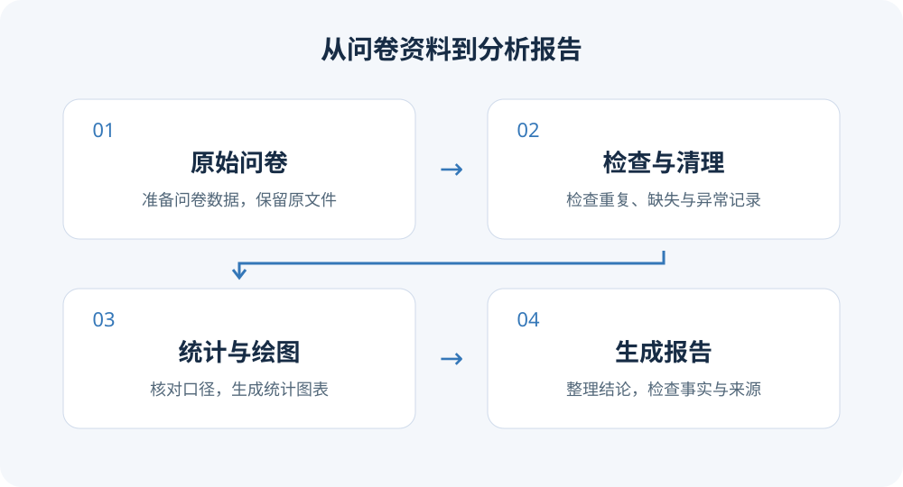
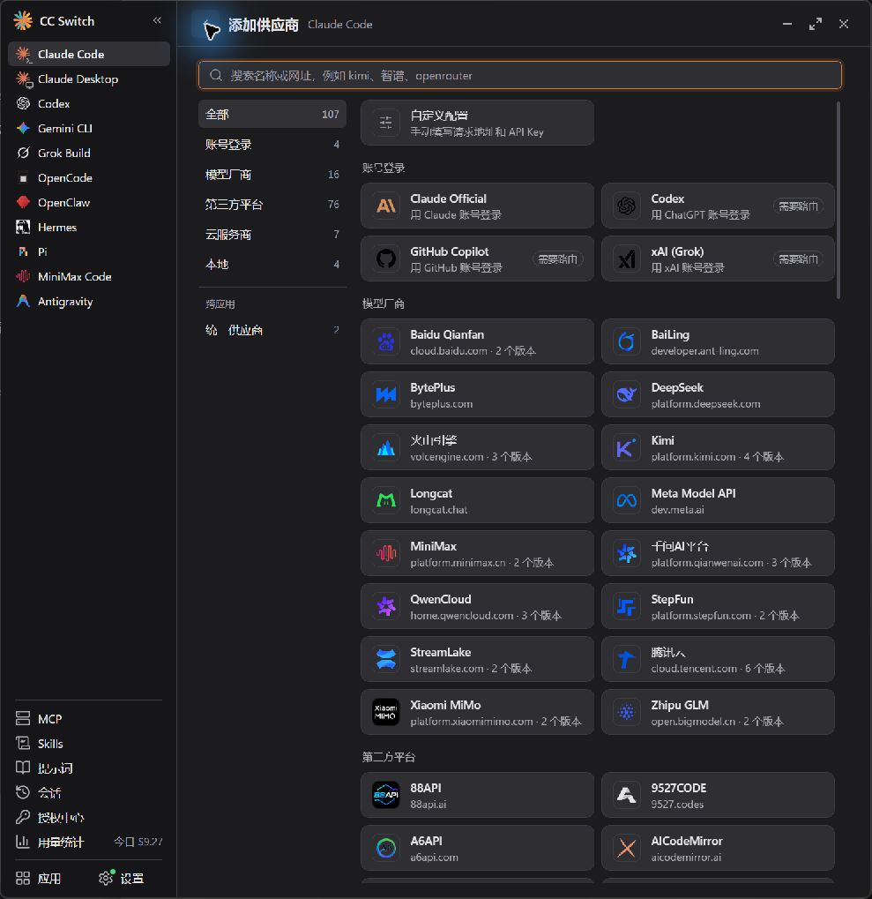
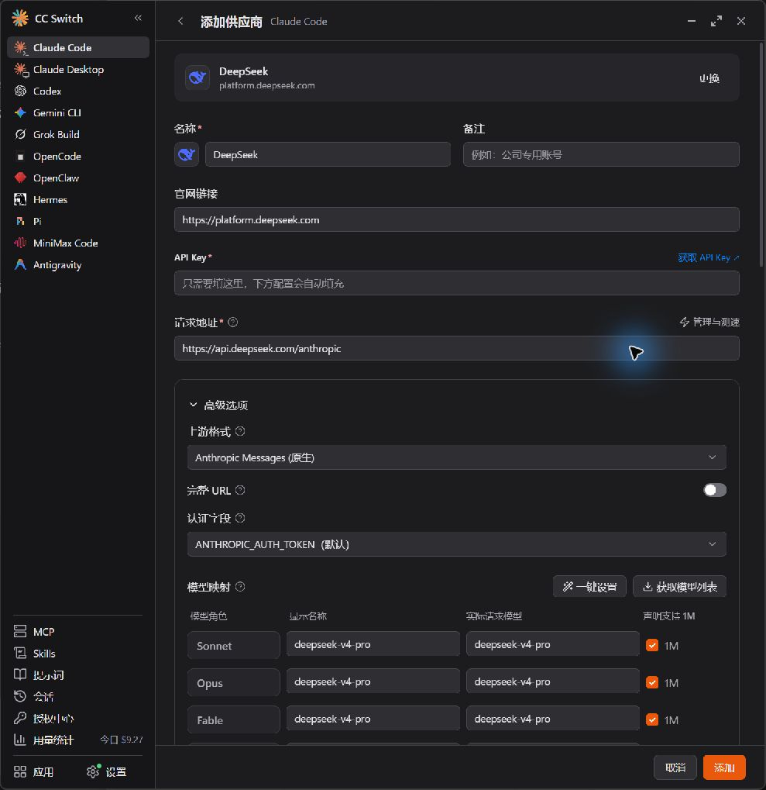
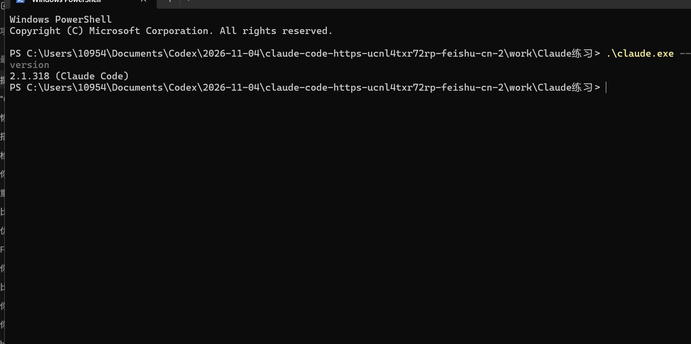
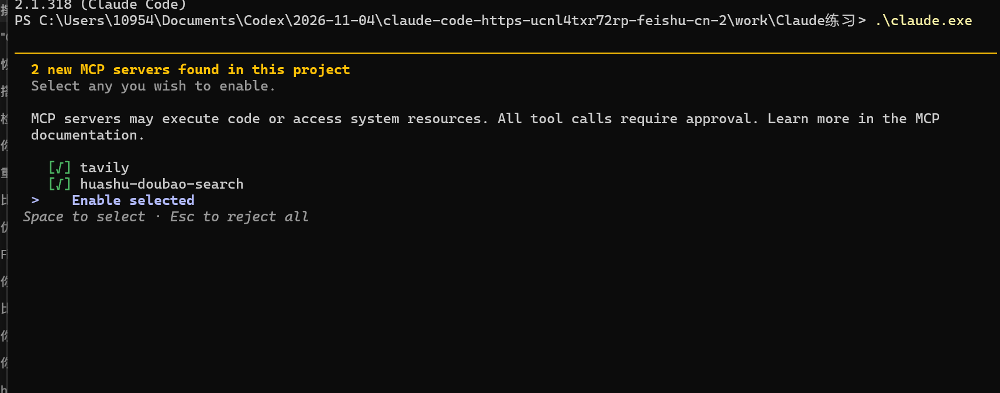
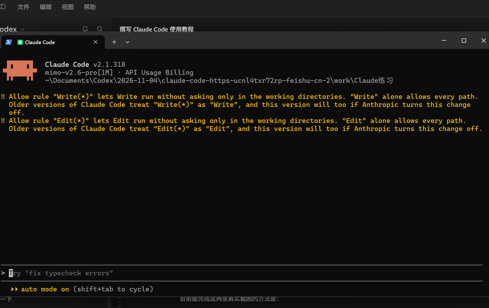
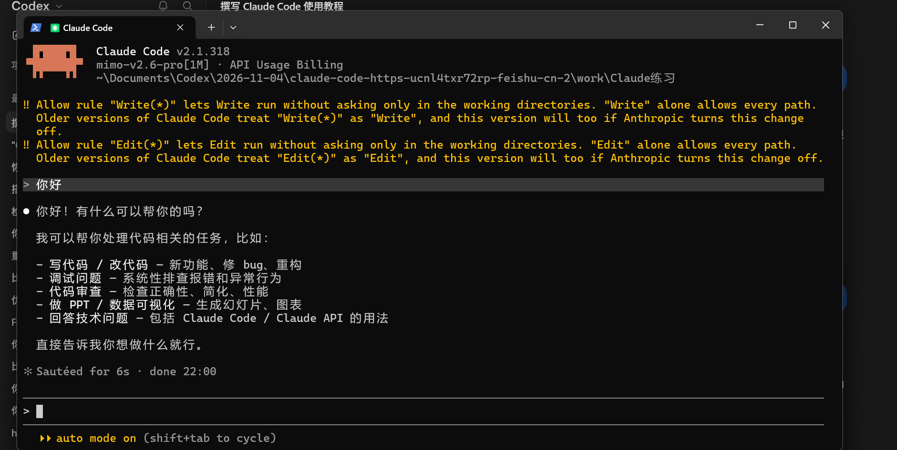
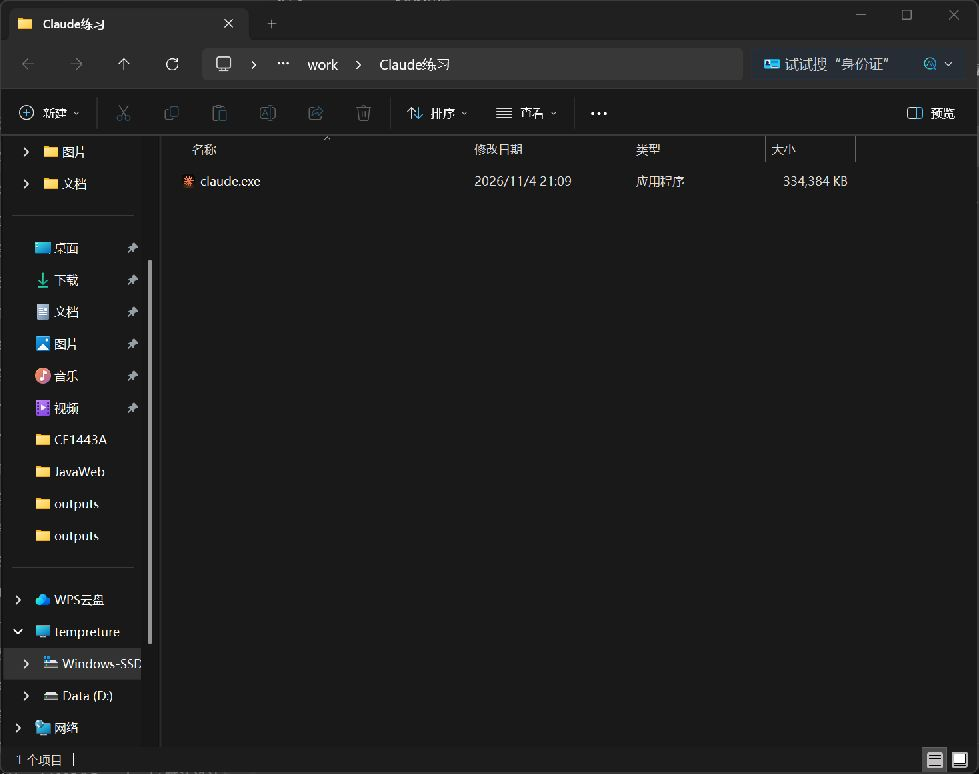
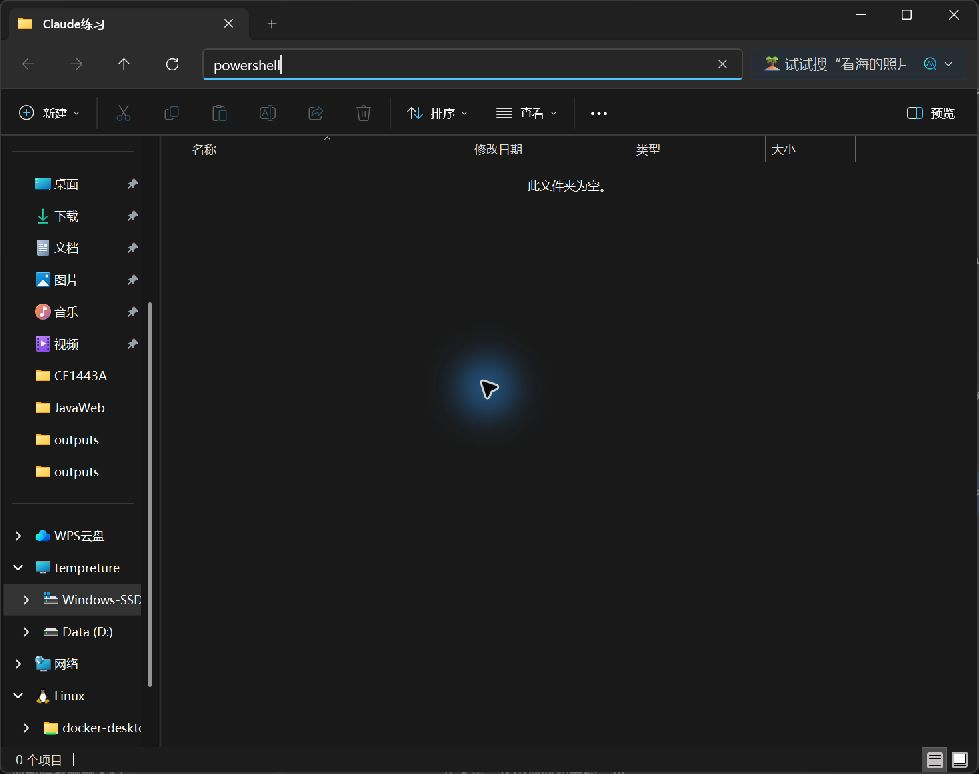
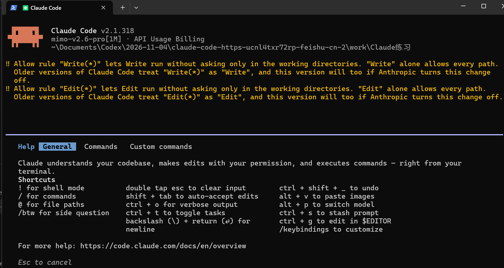

适用：Windows x64 电脑。通过 CC Switch 接入 DeepSeek，从安装到完成日常任务。

<div class="claude-tutorial-marker"></div>

## 阅读目录

1. [一、简介：为什么要用 Claude Code？](#tutorial-chapter-1)
2. [二、安装与配置：让 Claude Code 用上 DeepSeek](#tutorial-chapter-2)
3. [三、第一次用 Claude Code 干活：把杂乱资料整理成清单](#tutorial-chapter-3)
4. [四、跟着做一个完整项目：筹备一场读书分享会](#tutorial-chapter-4)
5. [五、接下来怎么练：把 AI 用到自己的生活和工作里](#tutorial-chapter-5)


---

<a id="tutorial-chapter-1"></a>

## 一、简介：为什么要用 Claude Code？

很多人第一次听到 Claude Code，会以为它是程序员专用的工具。其实，它也能帮助普通人整理资料、处理表格、分析数据，甚至制作自己的网页和小工具。

<strong>它和普通 AI 聊天工具的一个重要区别是：除了给出建议，它还可以在你的授权范围内读取文件、修改内容、运行程序，直接参与完成任务。</strong>你用日常语言描述需求，再检查结果、提出修改，就能逐步把想法变成实际成果。

### 1. 非工科生可以用它做什么？

- 📚 **学习与写作**：整理多份资料、提取主要观点、生成阅读笔记，辅助搭建报告框架。
- 📊 **表格与数据**：清理问卷数据、分类统计、制作图表，减少重复操作。
- 📁 **日常办公**：批量重命名文件、归类材料、汇总多份文档。
- 🌐 **表达与展示**：制作个人主页、活动页面，或把资料做成可以浏览和搜索的网页。

### 2. 工科生可以用它做什么？

- 💻 **辅助开发**：理解陌生项目、编写功能、排查报错、补充测试。
- 🧪 **辅助科研**：编写数据处理脚本、绘制实验图表、整理实验结果。
- ⚙️ **实现自动化**：把重复操作写成程序，让同类任务以后也能快速完成。

### 3. 一个具体例子：把问卷数据变成分析报告

假设你组织了一场校园活动，收到了 **200 份反馈问卷**。现在需要清理数据、统计满意度、整理意见，再交一份总结报告。你可以把导出的表格放进一个文件夹，向 Claude Code 提出要求：

> 请分析这个文件夹里的活动反馈问卷。
>
> 先检查缺失值和重复记录，说明准备如何处理，等我确认后再继续。
>
> 然后统计整体满意度、比较不同年级的反馈，并整理大家最常提到的建议。
>
> 最后生成一份带图表的分析报告，标明统计口径，不要修改原始文件。

在文件格式可读取、所需工具可用的情况下，它可以协助完成下面这条流程：



*图1｜从原始资料到报告，每一步都需要核对结果。*

如果你觉得图表不够清楚，还可以接着说：“把满意度按年级分别展示”“给每张图加上样本数量”“把结论改成适合汇报的三条要点”。

<strong>它的价值，是把原本分散在多个软件里的操作串起来，让你把更多精力放在判断问题和检查结果上。</strong>这个案例也不需要你先学会编程，但你仍然需要核对统计结果，并在处理问卷前去除姓名、手机号等个人信息。

---

<a id="tutorial-chapter-2"></a>

## 二、安装与配置：让 Claude Code 用上 DeepSeek

这一章，我们从下载安装材料开始，配置 DeepSeek，再让 Claude Code 完成第一个小任务。

<strong>不需要提前学编程，跟着步骤操作即可。</strong>本教程适用于普通 Intel、AMD 的 **Windows x64 电脑**，不适用于 Windows ARM 电脑。

<p><strong>开始前检查：</strong>本章按 Windows 10／11 操作。打开“设置 → 系统 → 关于”，查看“系统类型”，确认是 x64 处理器；如果写着 ARM，请先停止使用本材料包。准备能正常联网的电脑、用于练习的文件夹，以及 DeepSeek 开放平台账号和少量可用额度。前面的问卷分析是能力示例，后面从更容易检查的文字清单练起。</p>

### 1. 先认识三个工具

| 工具 | 负责什么？ |
| --- | --- |
| **Claude Code** | 读取文件、调用工具，执行你交代的任务 |
| **DeepSeek** | 理解要求、思考问题，提供模型能力 |
| **CC Switch** | 帮你配置 Claude Code 使用 DeepSeek |

三个工具的分工：Claude Code 读取文件、调用工具并执行任务；DeepSeek 提供理解与推理能力；CC Switch 管理模型连接配置。

本教程通过 **DeepSeek API** 调用模型。你可以把 API 理解为：让其他软件使用 DeepSeek 的接口。

### 2. 下载并解压安装材料

打开 [夸克网盘下载入口](https://pan.quark.cn/s/769d7b4ac058)，下载 **Windows-x64-完整安装材料-本地核验.zip**。

下载完成后：

1. 在压缩包上点击鼠标右键。
2. 选择 **全部解压缩**。
3. 选择保存位置，点击 **提取**。
4. 打开解压后的文件夹。

**先解压，再运行里面的程序，不要直接在压缩包中双击运行。**

<p>找不到下载文件时，在浏览器的“下载”列表点击“在文件夹中显示”；文件名通常以 .zip 结尾。若下载尚未完成、提示损坏或解压失败，先重新下载，不要继续运行缺失文件。网盘若要求登录或客户端，按页面提示处理；打不开分享链接时请联系作者更新链接，本教程未验证所有网络都能下载。</p>

解压后，主要使用这两个文件夹：

- **01-CC-Switch**：里面是 CC Switch 的 `.msi` 安装包。
- **02-Claude-Code本地核验**：里面是 Claude Code 的 `claude.exe` 程序。

> 当前材料为本地核验版本；尚未完成国内无代理环境下的完整使用测试。Claude Code 的公开再分发授权尚未确认。网盘链接由教程作者提供，尚未独立验证下载。

### 3. 安装 CC Switch

打开 **01-CC-Switch**，双击 `CC-Switch-v4.0.25-Windows.msi`。

#### ① 欢迎页面

点击 **Next（下一步）**。

| 按钮 | 意思 |
| --- | --- |
| Next | 下一步 |
| Back | 返回上一步 |
| Cancel | 取消 |
| Install | 开始安装 |
| Finish | 完成 |

#### ② 安装路径与快捷方式

在 **Destination Folder（安装位置）** 页面，初次使用建议保留默认路径：

```text
C:\Users\你的用户名\AppData\Local\Programs\CC Switch\
```

用户名会自动填写，不用照着输入。如果希望安装到 D 盘，点击 **Change…（更改）**，选择或填写 `D:\Apps\CC Switch\`，确认后返回。

建议勾选 **Create a desktop shortcut（创建桌面快捷方式）**，以后可以从桌面打开软件。检查路径后点击 **Next**。

#### ③ 开始安装

看到 **Ready to install CC Switch** 后，点击 **Install（安装）**，等待完成。需要修改路径时，点击 **Back（上一步）**。

#### ④ 完成

保留 **Launch CC Switch（启动 CC Switch）** 勾选，点击 **Finish（完成）**。

> 以上选项已核对这份 MSI 的内部页面设置。安装向导真实截图尚待补充。

### 4. 申请 DeepSeek API Key

打开 [DeepSeek 开放平台](https://platform.deepseek.com/)，按页面提示注册或登录。


*图 2-1｜DeepSeek 开放平台登录页面*

进入 **API Keys／API 密钥** 页面，创建密钥，名称可填“Claude Code 练习”。复制并妥善保存，下一步会用到。

<p><strong>操作顺序：</strong>登录后在导航中找“API Keys／API 密钥”，点“创建 API Key／创建密钥”或同义按钮，填名称并确认；创建成功后，用页面的复制按钮复制完整密钥，再粘贴到 CC Switch 的 API Key 输入框。列表里的掩码不是完整密钥；若已关闭创建窗口且平台不再显示全文，重新创建一把再使用。完成标志是密钥列表有这条记录，且你已把完整密钥填入 CC Switch；有密钥还要有可用余额才能调用。</p>

<strong>API Key 就像软件调用模型的通行证。</strong>不要公开分享完整密钥；泄露后应删除旧密钥并重新创建。

#### 额度和费用

在开放平台查看余额、充值入口和价格说明，确认有可用额度。API 与网页聊天分别计费。

以整个任务累计输入 **1 万 Token**、输出 **2000 Token**，且输入均未命中缓存为例：

| 模型 | 示例任务的模型费用 |
| --- | ---: |
| DeepSeek Flash | 约 0.02～0.04 元 |
| DeepSeek V4 Pro | 约 0.07～0.14 元 |

这是按核查时的空闲、高峰价格计算的用量示例，不是每个小任务的固定报价。文件量、思考过程和多次修改都会影响费用。先准备少量测试额度，完成后查看实际账单。价格以 [官方价格页](https://api-docs.deepseek.com/zh-cn/quick_start/pricing/) 为准。

<p>价格核查日期：2026 年 11 月 5 日。Token 是模型计算文字用量的单位，不等于汉字数；“输入 1 万、输出 2000”指整个任务各轮累计用量，包含反复带入的历史内容，不是单次输入框的字数。本章纯文本练习不要求联网搜索；若另行使用搜索等收费服务，还会产生相应费用。</p>

### 5. 在 CC Switch 中连接 DeepSeek

1. 点击左侧 **Claude Code**。
2. 点击 **添加供应商**。
3. 找到并选择 **DeepSeek**。



*图 2-2｜选择 DeepSeek 预设*

在 **API Key** 输入框粘贴自己的密钥。



*图 2-3｜填写 DeepSeek 配置*

| 配置项 | 怎么填写 |
| --- | --- |
| 名称 | 保留 DeepSeek |
| API Key | 填自己的 DeepSeek 密钥 |
| 请求地址 | `https://api.deepseek.com/anthropic` |
| 模型和高级选项 | 初次使用保留 DeepSeek 预设设置 |

点击 **添加**，回到列表后，将 DeepSeek **切换为当前使用的配置**。

<p>完成标志：DeepSeek 已出现在 Claude Code 的供应商列表中，并有“当前使用／已启用”或同义标记；仅添加到列表不等于已经切换。截图中的字段布局以你安装的版本为准。当前官方模型名包括 deepseek-flash、deepseek-v4-pro；若预设仍是旧名称、启动时报模型错误，请先核对 <a href="https://api-docs.deepseek.com/quick_start/agent_integrations/claude_code/">DeepSeek 官方接入说明</a>。不要把网页聊天模型名随意填进 API 配置。修改后先退出 Claude Code，再从工作文件夹重新启动。</p>

### 6. 安装 Claude Code（本材料包为直接运行版）

这份材料中的 Claude Code 是 **直接运行版**，没有“下一步”和“选择安装路径”的安装向导。将程序放到固定位置，就可以启动。

#### ① 找到程序

打开已经解压的安装材料，进入 **02-Claude-Code本地核验** 文件夹，找到 **claude.exe**。如果电脑隐藏了文件扩展名，可能只显示为 **claude**，文件类型为“应用程序”。

#### ② 选择存放位置

第一次练习，建议在桌面新建 **Claude练习** 文件夹，把 `claude.exe` 复制进去。先右键点击程序选择 **复制**，再打开练习文件夹，在空白处右键选择 **粘贴**。

这里的文件夹就是本次任务的工作区域，后续示例生成的文件也会保存在这里。程序放在桌面文件夹或 D 盘均可，例如 `D:\Claude练习\`，但后面的操作要始终打开自己实际选择的文件夹。

**确认复制的是 claude.exe 程序本身，而不是快捷方式；不要在 ZIP 压缩包中直接运行。**


*图 2-4｜claude.exe 已放入练习文件夹*

#### ③ 不用重复在线安装

这份包已经包含程序，不需要再输入在线安装命令，也不需要为了运行这个可执行文件额外安装 Node.js。

接下来从练习文件夹打开 PowerShell，检查版本并启动。这样比直接双击更容易看到运行提示。

### 7. 启动 Claude Code

#### ① 打开 PowerShell

打开练习文件夹，点击顶部 **地址栏**，输入 `powershell`，然后 **按 Enter（回车键）**。注意不是右侧搜索框。


*图 2-5｜地址栏输入 powershell*

> **Enter 就是键盘上的回车键，通常标有“Enter”或“↵”。输入命令后，需要按回车，电脑才会执行。**

<p>教学检查点：以下操作要分清窗口。PowerShell 中输入 .\claude.exe 或 .\claude.exe -c；进入 Claude Code 后才输入 /help、/exit、/resume 等命令。英文半角符号照抄，不要复制命令提示符。</p>

<p>第四章的命令如果未出现在当前版本的 / 菜单中，不必卡在这里：命名或上下文整理可以暂时跳过；恢复会话失败时，在同一项目文件夹重新启动，再要求 AI 读取“项目进度.md”和现有成果，核对后继续。恢复聊天不会回滚文件。</p>

<p>本文没有要求启用 auto mode、自动接受全部修改或关闭确认。第一次实操保持默认权限，按提示逐项确认。所有项目日期、采购价格和预算均为练习假设，实际使用请替换并核对。</p>

<p><strong>复制和粘贴：</strong>选中教程中的命令正文，按 Ctrl＋C 复制；点击 PowerShell 或 Claude Code 的输入位置，尝试 Ctrl＋V 粘贴。终端不响应时可用 Ctrl＋Shift＋V 或右键粘贴，以终端菜单为准。只复制命令本身，不复制代码框、PS 提示符和说明文字。先检查内容完整，再按 Enter（回车键）；若已自动发送，不要重复发送。</p>

<p><strong>怎么知道能输入下一条？</strong>等待当前任务结束、底部重新出现输入位置后再发送。若任务明显跑偏，按 Esc 尝试停止当前执行；停止后先查看已经生成的文件，再交代下一步。不要把关闭帮助页、停止任务和撤销文件修改当成同一件事。</p>

#### ② 检查程序是否能运行

在打开的 PowerShell 中输入：

```powershell
.\claude.exe --version
```

**按回车执行**。显示版本号，说明程序能够运行。



*图 2-6｜版本检查真实截图*

#### ③ 正式启动

接着输入：

```powershell
.\claude.exe
```

**按回车启动**。前面的 `.\` 表示运行当前文件夹里的程序，也要一起输入。

<p>首次启动可能出现主题、文件夹信任或模型连接提示。主题按个人喜好选择；如果询问信任文件夹，只在确认路径是自己刚创建的练习文件夹后继续。选择菜单通常用上下方向键移动、回车确认，以页面提示为准。如果被带到 Claude 官方订阅登录页面，先停止，不要为本教程购买 Claude 订阅：返回 CC Switch，确认添加在 Claude Code 栏目、已切换启用 DeepSeek，检查请求地址与密钥，再退出 Claude Code 并重新启动。仍要求登录时，请保留完整报错，回到本章常见问题排查，不要反复重装。</p>

如果之前已经打开过 Claude Code：在任务输入位置输入 `/exit`，**按回车退出**；回到 PowerShell 后，输入 `.\claude.exe`，**再按回车重新启动**，使新配置生效。

#### ④ 如果出现 MCP 提示

有些电脑会提示检测到了 MCP 扩展工具。MCP 可以先理解为给 Claude Code 增加功能的扩展。<strong>第一次练习不需要这些工具，可以按 Esc 拒绝本次启用并继续。</strong>全新电脑不一定出现这一页，没有出现就继续。



*图 2-7｜可选 MCP 工具提示*

#### ⑤ 认识启动界面

进入后，可以看到 Claude Code 版本、当前模型、工作文件夹，以及底部的任务输入位置。



*图 2-8｜Claude Code 真实启动界面*

> <strong>截图使用的是 MiMo，展示的是界面位置，不是 DeepSeek 接通结果。</strong>黄色权限提示和 auto mode 来自这台电脑的已有设置，新手不需要照着开启。接入 DeepSeek 后，应结合 CC Switch 配置及 DeepSeek 平台调用记录确认实际使用的服务。

### 8. 发送第一句话

在底部输入“你好”，**按回车发送**。收到回复，说明当前连接的模型可以响应。



*图 2-9｜Claude Code 首次对话真实截图*

这张同样是 **MiMo 对话示例**，用于展示在哪里输入、在哪里查看回复，不能单独证明 DeepSeek 已接通。

### 9. 让它完成第一个小任务

输入下面的要求，**按回车发送**：

> 请在当前文件夹创建一个“你好.txt”，内容是“我的 Claude Code 已经可以开始工作了”。

<p>若询问是否允许创建文件，看清路径和操作内容后允许。任务完成后回到练习文件夹，按 F5 刷新，双击“你好.txt”核对内容。通过标准分三步：① --version 只证明程序能运行；②“你好”收到回复只证明当前模型可响应；③文件实际生成且内容正确，才证明本次文件操作成功。确认 DeepSeek 时，还要核对 CC Switch 当前启用的供应商，并在 DeepSeek 开放平台用量记录中查找这次测试对应的调用（记录可能延迟）。不要只凭模型自称或 MiMo 示例截图判断。还可以到 DeepSeek 开放平台查看调用和扣费记录。</p>

### 10. 下次怎么打开和退出？

打开工作文件夹 → 地址栏输入 `powershell` 并回车 → 输入 `.\claude.exe` 并回车 → 输入任务并回车发送。

结束时，在 Claude Code 中输入 `/exit`，**按回车退出**。

### 实测补充：它真的能读资料、生成文件并继续修改吗？

2026 年 11 月 5 日，使用材料包中的 **Claude Code 2.1.318**，连接 **DeepSeek（deepseek-v4-pro）**，完成了下面这次实际测试。

**第一步：让 AI 根据资料生成文件。**

准备一份 `活动资料.txt`，写明：读书分享会，预计 20 人，暂定周六 14 点，地点为图书馆二楼，预算不超过 300 元；需要签到表、饮用水和海报，结束时间尚未确定。

向 AI 交代任务：

```text
读取活动资料.txt，生成活动准备清单.md，包含基本信息、准备物品和待确认问题。不要修改原始资料，不要编造结束时间，保留“暂定”等不确定信息。
```

如果你在 Claude Code 的对话输入框里照着练习，粘贴完这段话后，按 Enter（回车键）发送。遇到文件操作确认，先看清文件名和操作内容，再决定是否允许。

**第二步：继续修改刚才的成果。**

测试中恢复了同一个会话，再提出要求：

```text
把活动准备清单.md 中的准备物品改成三列表格：物品、数量、状态。数量统一写“待确认”，状态统一写“待准备”，其他内容保留。
```

实际生成的文件中，这一部分变成了：

| 物品 | 数量 | 状态 |
| --- | --- | --- |
| 签到表 | 待确认 | 待准备 |
| 饮用水 | 待确认 | 待准备 |
| 海报 | 待确认 | 待准备 |

<strong>检查结果：</strong>文件确实生成并完成修改；“暂定周六 14 点”和“结束时间未确定”得到保留；对比原始资料的文件校验值，确认它没有被修改。

你练习时也要打开实际文件检查，而不只看 AI 说“已完成”。到练习文件夹中找到 `活动准备清单.md`，用记事本打开；如果之前已经打开过，关闭后重新打开，确认看到最新内容。

<strong>这次测试的范围：</strong>采用独立配置目录，通过非交互命令行完成两轮真实 API 调用，只开放读取、写入和编辑文件工具。这验证了这组客户端与模型的文件处理能力；尚未覆盖全新电脑安装、CC Switch 图形界面切换、交互快捷键，以及国内无代理网络环境。当前测试电脑有加速网络。

<strong>这次花了多少钱？</strong>尚未核对 DeepSeek 平台账单，因此不填写实际金额。客户端提示无法识别该模型的计价信息，其美元估算不能作为扣费凭据。请到 DeepSeek 开放平台查看实际用量与账单；同类任务的费用也会随材料长度、对话轮数和模型变化。


### 11. 常见问题

<p>排查顺序：先核对窗口与文件夹，再核对配置，最后查看报错；不要一上来重装。</p>

<p>找不到程序：在练习文件夹确认存在 claude.exe，注意不要重复 .exe 后缀；在 PowerShell 输入 .\claude.exe --version 并回车，前面的 .\ 也要复制。</p>

<p>密钥或额度问题：401 通常先检查密钥是否完整、有效；余额不足按 DeepSeek 平台账单核对。400、模型不存在或工具不支持时，重新核对 DeepSeek 预设、请求地址和模型映射。不要把完整密钥截图发给别人。</p>

<p>文件没有出现：按 F5 刷新；让 AI 只报告实际保存的完整路径，不要重建文件。对照路径检查，必要时在 PowerShell 输入 Get-Location 并回车查看当前文件夹。</p>

<p>复制命令时只复制代码内容，不复制 PS C:\...&gt;、代码框符号或截图里的文件路径。Ctrl＋S 在记事本中保存文件，在 Claude Code 中可能暂存输入，二者不同。</p>

*本稿已加入程序位置、终端版本检查、启动界面及首次对话的真实截图；解压、CC Switch 安装向导和 DeepSeek 密钥创建截图尚待补充。*

---

<a id="tutorial-chapter-3"></a>

## 三、第一次用 Claude Code 干活：把杂乱资料整理成清单

这一章，我们一起完成一个小任务：**把一段零散的活动资料，整理成一份可以直接查看和修改的准备清单。**

你会学会准备材料、发送要求、查看结果，以及让 AI 继续修改。不会写代码也没关系。

### 1. 准备好工作文件夹

打开上一章创建的 **Claude练习** 文件夹，里面应该已经有 `claude.exe`。

如果没有，打开之前解压的安装材料，进入 **02-Claude-Code本地核验** 文件夹，将 `claude.exe` 复制过来。

这个文件夹就是我们这次工作的地方。**原始材料和生成的结果都放在这里，方便找到。**



*图 3-1｜练习文件夹中的 claude.exe*

### 2. 创建一份练习资料

#### 第一步：新建文本文件

在“Claude练习”文件夹空白处点击鼠标右键，选择 **新建 → 文本文档**。

将新文件命名为 `活动资料`，**按回车确认**。如果电脑显示文件扩展名，完整名称应该是 `活动资料.txt`。

> 如果新建文件原本只显示“新建文本文档”，重命名时输入“活动资料”即可，不要额外加 `.txt`，避免变成“活动资料.txt.txt”。

<p><strong>不确定后缀是否重复？</strong>Windows 11 在文件夹顶部选择“查看 → 显示 → 文件扩展名”；Windows 10 在“查看”选项卡勾选“文件扩展名”。确认完整名称是“活动资料.txt”。如果右键菜单没有“文本文档”，从开始菜单搜索并打开记事本，粘贴材料，按 Ctrl＋Shift＋S 另存为，选择“Claude练习”文件夹，文件名填“活动资料.txt”，编码选 UTF-8，再点保存。</p>

#### 第二步：填写材料

双击文件，用记事本打开。复制下面这段示例资料，粘贴进去：

```text
我们准备举办一场读书分享会，预计20人参加。
时间暂定周六下午两点，地点是学校图书馆二楼。
每个人带一本想分享的书。
需要准备签到表、饮用水和宣传海报。
目前有3名同学帮忙，但还没有分工。
预算不超过300元。
活动结束时间还没有确定。
```

#### 第三步：保存文件

按住 **Ctrl**，再按一下 **S**，也就是 **Ctrl＋S**，保存内容，然后关闭记事本。

此时文件夹里应该有：

```text
Claude练习
├─ claude.exe
└─ 活动资料.txt
```

**完成标志：重新打开“活动资料.txt”，能看到刚才保存的七行内容。**

### 3. 打开 Claude Code

#### 第一步：打开 PowerShell

在“Claude练习”文件夹里，点击窗口顶部的 **地址栏**，输入：

```text
powershell
```

<strong>按 Enter（回车键）。</strong>注意是顶部显示路径的地址栏，不是右侧搜索框。



*图 3-2｜在地址栏输入 powershell*

#### 第二步：启动程序

在打开的 PowerShell 中输入：

```powershell
.\claude.exe
```

<strong>按回车启动。</strong>等待进入 Claude Code，顶部会显示程序信息，底部是输入任务的位置。


*图 3-3｜Claude Code 启动界面示例*

> 这张截图使用 MiMo，仅展示界面位置。本教程模型配置仍按上一章接入 DeepSeek。截图中的权限提示和 auto mode 不需要照着设置。

<strong>完成标志：底部出现可以输入任务的位置。</strong>如果上一章的 Claude Code 还开着，而且就在同一练习文件夹里，可以直接继续使用。

### 4. 先让它确认找到了材料

先不急着生成整份文件。在底部输入：

> 请查看当前文件夹，告诉我有没有“活动资料.txt”。如果有，请读出文件内容，先不要修改或创建任何文件。

<strong>按回车发送。</strong>等待回复，不要在尚未完成时连续重复发送。

#### 如果出现操作确认

它可能询问是否允许读取文件。检查文件名和路径，确认是刚才创建的“活动资料.txt”，再按界面提示允许。不同版本的选项可能不同，以实际显示为准。

<p>确认菜单通常用上下方向键选中选项，再按 Enter（回车键）。第一次练习优先选 Yes／Allow once（允许本次）这类单次选项；不必选“以后全部允许”。若屏幕已经显示正在读取而没有询问，继续等结果即可，不需要特意找确认按钮。</p>

#### 检查回复

看看读出的内容是否与保存的资料一致。

**完成标志：它找到了文件，并正确读出了活动资料。**

如果找不到，可以回复：

> 请告诉我你当前所在的文件夹路径，以及这里有哪些文件。

<strong>按回车发送。</strong>将路径与自己的练习文件夹比较。如果路径不一致，输入 `/exit` 并**按回车退出**，再从正确文件夹的地址栏打开 PowerShell，输入 `.\claude.exe` 并**按回车启动**。

### 5. 正式交代整理任务

确认材料读取正确后，继续输入下面这段话。第一次练习可以整段复制；粘贴后检查内容是否完整。如果已经自动发送，不用再按一次回车。

> 请根据刚才的“活动资料.txt”，整理一份活动准备清单。请分成三部分：一、活动基本信息；二、需要准备的物品；三、待确认问题。保留原文中“暂定”的意思，没有写明的信息不要编造，也不要修改原始文件。请把结果保存为当前文件夹中的“活动准备清单.md”。

**如果内容还在输入框中，按回车发送。**

| 要说清什么？ | 我们怎么说的？ |
| --- | --- |
| 根据什么材料 | 活动资料.txt |
| 要完成什么 | 整理活动准备清单 |
| 有什么要求 | 分三部分、保留“暂定”、不编造 |
| 保存在哪里 | 当前文件夹的活动准备清单.md |

不必一字不差地照抄。**说清材料、任务、要求和结果位置，就能开始。**

### 6. 等待执行，看懂中间提示

Claude Code 可能会显示正在读取文件、整理内容或创建文件。这是在展示操作过程，不是要求你写代码。

如果询问是否允许创建文件，确认目标是 **活动准备清单.md**，路径也在练习文件夹内，再允许执行。

<p>如果准备删除原始资料、修改无关文件，或执行你看不懂且与任务无关的操作，先不要允许。用方向键选 No／Reject（拒绝）并按回车，或按该页面标注的 Esc 取消；回到任务输入框后，再输入下面这句话请它解释。不要在权限选择菜单里直接输入任务。</p>

例如输入：

> 我只需要读取活动资料并创建清单。请解释为什么需要这项操作，先不要执行。

<strong>按回车发送。</strong>

<strong>完成标志：它回复任务完成，并说明结果文件已经保存。</strong>下一步还要亲自打开检查，不能只看它说“完成”。

### 7. 找到并打开结果文件

回到练习文件夹。如果没有看到新文件，按 **F5** 刷新。正常情况下，会多出 **活动准备清单.md**。

#### .md 是什么？

它是一种文本文件格式，常用于保存标题、列表和表格。

右键点击文件，选择 **打开方式 → 记事本**。如果列表里没有记事本，点击“选择其他应用”，再找到记事本。

打开后可能看到类似内容：

```text
# 活动准备清单

## 一、活动基本信息

- 活动：读书分享会
- 预计人数：20人
- 时间：暂定周六下午两点
```

其中的 `#` 和 `-` 用来表示标题和列表，**不是报错**。你现在只需要能读懂内容。

### 8. 对照原材料，检查结果

| 检查项 | 正确表现 |
| --- | --- |
| 人数 | 预计20人 |
| 时间 | 保留“暂定周六下午两点” |
| 地点 | 学校图书馆二楼 |
| 预算 | 不超过300元 |
| 结束时间 | 标为待确认，没有自行决定 |
| 原始文件 | 活动资料.txt 仍然保留 |

AI 也可能提出“是否需要报名”“物品数量是多少”等问题。**只要明确标为待确认问题，没有写成已确定的事实，就可以供你进一步考虑。**

如果发现错误，回到 Claude Code，输入：

> 你把“暂定周六下午两点”写成了已经确定的时间，请改回“暂定”，并检查其他内容是否也把未确定的信息写成了事实。更新“活动准备清单.md”。

<strong>按回车发送。</strong>完成后关闭并重新打开结果文件，查看更新。

### 9. 让它根据反馈继续修改

回到 Claude Code，输入：

> 请把“需要准备的物品”改成表格，包含“物品”“数量”“是否准备完成”三列。资料中没有数量的项目填写“待确认”；“是否准备完成”统一填写“待准备”。其他内容保留，更新“活动准备清单.md”。

<strong>按回车发送。</strong>修改后重新打开文件，检查是否出现类似内容：

| 物品 | 数量 | 是否准备完成 |
| --- | --- | --- |
| 签到表 | 待确认 | 待准备 |
| 饮用水 | 待确认 | 待准备 |
| 宣传海报 | 待确认 | 待准备 |

这是预期结构示例，不是实际运行结果。虽然预计20人参加，也不能直接认定饮用水就是20瓶。**没有确定的数量，先标注待确认。**

这一步练习的是：第一次给任务，之后继续提出具体修改，不用每次从头解释。

### 10. 不知道怎么说，就让它先问你

输入：

> 我想把这份活动资料整理得更实用，但还没想好具体要求。请先问我3个最关键的问题，等我回答后再修改文件。

<strong>按回车发送。</strong>它提问后，照常回答。例如：

> 清单给3名筹备同学使用，希望简洁一点。目前还没有确定分工，先不要写负责人。

<strong>按回车发送。</strong>不需要一开始就写出完美要求，通过几轮对话逐渐补充，也是在正常使用 AI。

### 11. 保存成果，结束练习

检查文件夹里有这些内容：

```text
Claude练习
├─ claude.exe
├─ 活动资料.txt
└─ 活动准备清单.md
```

| 文件 | 用途 |
| --- | --- |
| claude.exe | 运行程序 |
| 活动资料.txt | 原始材料 |
| 活动准备清单.md | AI 整理后的成果 |

确认成果已经保存后，回到 Claude Code，输入：

```text
/exit
```

<strong>按回车退出。</strong>退出程序不会删除这些文件，你仍可以查看、修改或复制清单。

### 12. 以后交代任务，可以照这个模板说

> 请读取【文件名或材料位置】，帮我完成【具体任务】。  
> 结果需要包含【内容或结构】，用于【用途或读者】。  
> 请遵守【具体要求】，不确定的信息请提问或标注，不要编造。  
> 最后保存为【文件名】，保留原始文件。

例如，把活动资料换成会议记录：

> 请读取“会议记录.txt”，整理出会议结论、待办事项和待确认问题。负责人、截止时间没有写明的，标注为待确认。保存为“会议待办清单.md”，不要修改原文件。

<strong>输入后按回车发送。</strong>先给材料，再说要求；完成后检查，不满意就继续修改。这就是用 Claude Code 帮忙干活的基本流程。

---

<a id="tutorial-chapter-4"></a>

## 四、跟着做一个完整项目：筹备一场读书分享会

上一章，我们整理了一份活动清单。这一章，我们把它继续做成一个完整项目：**准备好活动方案、人员分工、预算表和宣传文案。**

你还会在做项目时学会查看帮助、引用文件、给对话命名、退出后继续，以及整理较长的对话。**不用背命令，跟着做，用到哪个就学哪个。**

### 1. 这次要完成什么？

假设你是读书分享会的负责人，需要把筹备材料交给其他同学使用。

| 文件 | 用途 |
| --- | --- |
| 活动方案.md | 说明活动怎么进行 |
| 分工与准备清单.md | 说明谁负责、何时完成 |
| 活动预算.md | 说明准备花多少钱 |
| 宣传文案.md | 用于发布活动通知 |
| 项目进度.md | 记录进度，方便下次继续 |

这次练习只在电脑里生成文件，宣传文案由你检查并自行发布。

<p><strong>这是一个新项目：</strong>第三章的时间仍为“暂定”，本章改用下面提供的“项目资料.txt”，练习已经确认时间、场地和分工后的筹备流程。请新建项目文件夹，使用本章资料，不要覆盖第三章的原始资料，也不要把两章的条件混在一起。</p>

### 2. 先分清两种输入位置

| 在哪里输入？ | 输入什么？ |
| --- | --- |
| PowerShell，尚未进入 Claude Code | `.\claude.exe`、`.\claude.exe -c` |
| Claude Code 的任务输入位置 | 日常要求，以及 `/help`、`/rename` 等命令 |

<p>看到 PS C:\…&gt; 通常是在 PowerShell。进入 Claude Code 后，底部是平时发送任务的位置。以 / 开头的命令，要在 Claude Code 里输入。</p>

不同版本和配置的选项可能不同，以实际菜单为准。[官方命令说明](https://code.claude.com/docs/en/commands)

### 3. 建立项目文件夹

#### 第一步：创建文件夹

在桌面空白处右键点击，选择 **新建 → 文件夹**，输入 `读书分享会项目`，**按回车确认**。

#### 第二步：复制程序

打开上一章的“Claude练习”文件夹，复制 **claude.exe**，粘贴到新项目文件夹里。

#### 第三步：准备项目资料

在新文件夹空白处右键点击，选择 **新建 → 文本文档**，命名为 **项目资料.txt**。如果电脑隐藏扩展名，只输入“项目资料”，不要重复添加 `.txt`。

打开文件，粘贴：

```text
活动名称：周末读书分享会

活动时间：2026年11月14日，星期六，14:00—16:00。
活动地点：学校图书馆二楼活动室，已确认可以使用。
活动人数：20名参与者，另有3名工作人员。
活动预算：不超过300元。
活动内容：每位参与者带一本书，以自愿方式分享，不要求所有人上台。

工作人员：
小林负责主持和活动流程。
小周负责签到、报名统计和现场引导。
小陈负责物品采购和宣传文案。

现有条件：
活动室桌椅和投影设备免费使用。
不收取报名费，不安排餐食。

可参考的采购价格：
饮用水每瓶2元。
纸杯每包8元，一包50只。
打印每张0.5元。
其他物品如有需要，请先列出，不要编造价格。

尚未确定：
报名方式。
对外咨询的联系人和联系方式。
是否需要购买其他物品。

要求：
所有安排先形成草稿，由负责人检查。
不替我们发送通知、提交报名信息或购买物品。
```

这是**练习用的假设资料和价格**。按 **Ctrl＋S** 保存，关闭记事本。

**完成标志：文件夹里有 claude.exe 和项目资料.txt。**

### 4. 启动程序，认识帮助页面

#### 第一步：启动 Claude Code

打开项目文件夹，在顶部地址栏输入 `powershell`，**按回车**。

在 PowerShell 中输入：

```powershell
.\claude.exe
```

<strong>按回车启动。</strong>

#### 第二步：打开帮助

进入 Claude Code 后输入：

```text
/help
```

<strong>按回车执行。</strong>



*图 4-1｜Claude Code 帮助页面真实截图*

> 截图使用 MiMo，主要展示帮助页面和按键位置，不代表 DeepSeek 接通结果。顶部黄色提示来自截图电脑已有的权限设置，不需要照着配置。

#### 第三步：看懂英文和按键

| 英文 | 中文 |
| --- | --- |
| Help | 帮助 |
| General | 通用说明 |
| Commands | 命令列表 |
| Custom commands | 自定义命令 |
| Shortcuts | 快捷键 |
| Esc to cancel | 按 Esc 关闭当前页面 |

先浏览，不需要一次看懂全部内容。看完后，**按 Esc 返回任务输入位置**。

<p>先练三个按键就够：在任务输入框输入 /help 并回车，打开帮助后按 Esc 返回；输入一小段文字，暂时不要发送，用退格键删除。换行先按帮助页当前显示的方法操作，确认文字仍留在输入框后再继续。整段粘贴后先检查是否完整，再按回车；如果已经发送，不要重复发送。</p>

<p>帮助页里的快捷键受版本、键盘布局和终端影响。Ctrl＋Shift＋下划线的撤销针对输入编辑，不是撤销项目文件；需要恢复文件时先停下并使用备份。Shift＋Tab 会切换操作模式，第一次练习保持默认模式，不需要自动接受全部修改。</p>

| 按键或输入 | 作用 | 新手怎么用？ |
| --- | --- | --- |
| `/` | 查看命令 | 输入英文 `/`，查看菜单 |
| `@` | 引用文件路径 | 输入英文 `@`，按提示选择文件 |
| `/btw` | 临时问旁支问题 | 后面接临时问题 |
| `!` | 终端命令模式 | 执行系统命令，本章不用 |
| 连续按两次 Esc | 清空当前输入 | 清除未发送的文字 |
| Shift＋Tab | 切换操作模式 | 新手保留默认设置，不必开启自动接受修改 |
| Ctrl＋O | 展开或收起详细输出 | 查看执行细节 |
| Ctrl＋T | 显示或隐藏任务列表 | 查看任务情况 |
| `\`＋回车 | 输入时换行 | 先输入反斜杠，再按回车 |
| Ctrl＋Shift＋`_` | 撤销输入编辑 | 截图中的快捷键，不等于恢复全部文件修改 |
| Alt＋V | 粘贴图片 | 需剪贴板有图片，模型也要支持图片 |
| Alt＋P | 切换模型 | 接外部模型时先不要随意切换 |
| Ctrl＋S | 暂存当前输入 | 不是保存项目文件 |
| Ctrl＋G | 用外部编辑器编辑输入 | 需配置编辑器，本章不用 |
| `/keybindings` | 自定义快捷键 | 新手先不调整 |

> <strong>组合键怎么按？</strong>例如 Ctrl＋O：按住 Ctrl，再按一下字母 O，然后松开。Shift＋Tab 同理。
>
> 截图中的下划线 `_` 通常需要 Shift＋减号键输入，具体撤销映射以当前版本和终端为准，第一次练习可先不用。

<strong>同一个按键，在不同软件里可能作用不同。</strong>记事本中的 Ctrl＋S 是保存，Claude Code 帮助页中的 Ctrl＋S 是暂存输入。

先记住：**回车发送、Esc 关闭当前页面、/help 查看帮助。**

### 5. 给这次对话起名字

输入：

```text
/rename 读书分享会筹备
```

<strong>按回车执行。</strong>这能方便以后查找对话。对话名称与文件夹名称是两回事，改对话名不会改文件夹。

### 6. 先让 AI 理解项目

输入下面的要求，**按回车发送**：

> 请读取当前文件夹里的“项目资料.txt”。先用简短文字复述活动目标、已确定条件和待确认事项，再提出完成项目的步骤。最终需要活动方案、分工与准备清单、活动预算、宣传文案四份文件。现在只讨论计划，先不要创建或修改文件。

#### 也可以用 @ 选择文件

在输入位置输入英文 `@`，查看文件建议，找到 **项目资料.txt**，按菜单提示选择，再补充要求：

<p>选择文件时可以继续输入“项目资料”筛选，按上下方向键移动，再按 Tab 或界面指定的确认键选中文件。这里的确认是选文件，不是发送整个任务。若没有建议列表，按 Esc 关闭菜单，直接使用上一段写明文件名的要求即可。</p>

> 请读取我引用的这份资料，先复述活动条件并提出计划，暂时不要修改文件。

<strong>按回车发送。</strong>两种方法选一种，不需要重复交代。

检查时间是否14:00—16:00、是否区分20名参与者和3名工作人员、预算是否不超过300元、未定事项是否仍标注待确认。

如果理解错了，输入：

> 工作人员还有3人，采购数量需要考虑他们。请修正计划，先不要生成文件。

<strong>按回车发送。</strong>确认计划后再输入：

> 计划可以。接下来按我逐步交代的要求执行，每完成一步告诉我生成了什么文件，先不要一次生成全部内容。

<strong>按回车发送。</strong>

### 7. 制作第一份成果：活动方案

输入：

> 请先生成“活动方案.md”。包含活动基本信息、14:00—16:00的流程表、工作人员提前到场的准备安排，以及待确认事项。分享采用自愿方式，不要安排20个人全部上台。所有时段要衔接，不能超出活动时间。保留“项目资料.txt”不变。

<strong>按回车发送。</strong>如需允许读取或创建文件，检查路径和文件名后按提示允许。

回到文件夹，找到 **活动方案.md**；没有看到时按 **F5** 刷新。右键选择 **打开方式 → 记事本**。

| 检查项 | 要看什么？ |
| --- | --- |
| 时间 | 14:00开始、16:00结束 |
| 流程 | 有开场、分享、交流和结束 |
| 人数 | 区分参与者和工作人员 |
| 分享方式 | 保留自愿原则 |
| 未定信息 | 标注待确认，没有擅自补全 |

需要调整时输入：

> 请增加自由交流时间，减少主持人介绍时间，总时长仍保持两小时。更新“活动方案.md”。

<strong>按回车发送。</strong>完成后重新打开文件检查。

### 8. 制作第二份成果：分工清单

输入：

> 请根据“项目资料.txt”和“活动方案.md”，生成“分工与准备清单.md”。用表格列出任务、负责人、建议完成时间、完成状态。负责人沿用已有分工，不新增人员。时间节点属于建议，请标清楚；未实际完成的任务统一标为“待完成”。

<strong>按回车发送。</strong>检查分工是否与资料一致、任务是否具体、有没有把建议写成承诺、有没有凭空标记已完成。

太笼统时输入：

> “完成现场准备”太笼统，请拆成可以逐项检查的小任务。保留负责人，更新清单。

**按回车发送。完成标志：其他同学能看懂自己要做什么。**

### 9. 中途退出，练习下次继续

#### 第一步：保存进度

输入：

> 请生成“项目进度.md”，记录已经完成的文件、已经确认的决定、仍待确认的问题，以及下一步要做什么。不要把建议写成已确认决定。

<strong>按回车发送。</strong>确认文件生成后再退出。

#### 第二步：退出

输入 `/exit`，**按回车退出**。回到 `PS C:\…>` 的 PowerShell。

#### 第三步：继续最近一次对话

在**同一项目文件夹的 PowerShell 中**输入：

```powershell
.\claude.exe -c
```

<strong>按回车执行。</strong>`-c` 继续当前目录最近一次对话。[官方启动命令说明](https://code.claude.com/docs/en/cli-reference)

进入后输入：

> 我们继续。请先查看“项目进度.md”和现有文件，告诉我现在做到哪里，先不要修改文件。

<strong>按回车发送。</strong>核对后再继续。

#### 找更早的对话

在 Claude Code 输入 `/resume`，**按回车执行**。找到 **读书分享会筹备**，按菜单提示选择并确认，通常用方向键选择、回车确认。

<strong>恢复对话不等于恢复文件旧版本。</strong>文件后来修改过，仍要检查。

<p>如果关掉了整个窗口：重新打开“读书分享会项目”文件夹，在地址栏输入 powershell 并回车，再输入 .\claude.exe -c 并回车。不能从其他文件夹随便打开，否则可能找不到本项目最近的对话。</p>

<p>如果没有找到历史对话：先按 Esc 关闭选择页面，再用普通启动命令进入；告诉 AI“先读取项目进度.md和当前文件，复述已完成、待完成事项，先不要修改”。核对正确后继续，不要为恢复聊天而删除成果文件。</p>

### 10. 制作第三份成果：预算表

输入：

> 请根据项目资料和现有方案，生成“活动预算.md”。饮用水暂按23人、每人1瓶估算；纸杯暂按1包估算；打印暂按10张估算。分别列出单价、数量、小计、合计和剩余预算，并展示计算过程。将这些数量标为预算假设，未提供价格的其他物品放入“待询价项目”，不要计入已知金额。

<strong>按回车发送。</strong>打开文件，核对：

| 项目 | 计算 | 金额 |
| --- | --- | ---: |
| 饮用水 | 23 × 2元 | 46元 |
| 纸杯 | 1 × 8元 | 8元 |
| 打印 | 10 × 0.5元 | 5元 |
| 已知费用合计 | 46＋8＋5 | **59元** |
| 相对300元预算的余额 | 300－59 | **241元** |

**241元不是最终结余**：待询价项目尚未计入，也没有实际采购。

计算或表述有误时输入：

> 请重新核对预算计算。已知费用应为59元，未计入待询价项目之前，相对预算还剩241元。请检查并修正，不要写成最终结余。

**按回车发送。完成标志：计算正确、假设清楚、没有编造价格。**

### 11. 制作第四份成果：宣传文案

输入：

> 请根据已经确认的活动资料，生成“宣传文案.md”，包含一份150字以内的群通知和三个可选标题。报名方式、联系人、联系方式还没确定，请用醒目的【待补充】标记。不要编造嘉宾、奖品、报名链接，也不要替我发布。

<strong>按回车发送。</strong>检查时间地点、带书提醒、自愿原则、待补充标记，以及有无不存在的承诺。

需要调整语气时输入：

> 语气再自然一些，适合发在同学群里。不要用夸张宣传词，保留所有待补充标记。

**按回车发送。完成标志：文案可供审阅，但需补全信息后才能发布。**

### 12. 对话变长时，查看和整理上下文

上下文可先理解为：**模型当前用来理解任务的聊天记录和材料。**

输入 `/context`，**按回车执行**，查看使用情况，先知道这里能查看，不用看懂每个数字。

对话很短就直接继续，**不用为了练习而强行压缩**。如果已多轮修改，先更新“项目进度.md”，再输入：

```text
/compact 保留活动条件、已确认决定、四份成果文件名和待确认事项
```

<strong>按回车执行。</strong>完成后要求重新读取进度文件，核对下一步。

<strong>压缩不是备份，也不保证保留每个细节。</strong>重要决定仍要写进文件。[命令说明](https://code.claude.com/docs/en/commands)

### 13. 最后检查，完成交付

输入：

> 请交叉检查“活动方案.md”“分工与准备清单.md”“活动预算.md”“宣传文案.md”。检查时间、地点、人数、分工和预算是否一致，是否把待确认信息写成了事实。先列出问题，不要修改文件。

<strong>按回车发送。</strong>看完后决定哪些要改，例如：

> 请修正你列出的第1项和第2项。其余内容保留，修改后告诉我分别更新了哪些文件。

<strong>按回车发送。</strong>最后自己打开四份文件核对。AI 自查可以帮忙，但不能代替负责人的确认。

再输入：

> 请更新“项目进度.md”，列出最终成果文件、待负责人确认的事项，以及正式发布前还要补充的信息。

<strong>按回车发送。</strong>项目文件夹应有：

```text
读书分享会项目
├─ claude.exe
├─ 项目资料.txt
├─ 活动方案.md
├─ 分工与准备清单.md
├─ 活动预算.md
├─ 宣传文案.md
└─ 项目进度.md
```

确认后输入 `/exit`，**按回车退出**。

### 14. 本章命令速查

| 命令 | 输入位置 | 什么时候用？ |
| --- | --- | --- |
| `.\claude.exe` | PowerShell | 启动 |
| `/help` | Claude Code | 查看帮助 |
| `/rename 读书分享会筹备` | Claude Code | 给对话命名 |
| `@` | Claude Code | 按菜单引用文件 |
| `/exit` | Claude Code | 退出 |
| `.\claude.exe -c` | PowerShell | 继续当前目录最近对话 |
| `/resume` | Claude Code | 恢复较早对话 |
| `/context` | Claude Code | 查看上下文 |
| `/compact 保留事项` | Claude Code | 对话较长时整理上下文 |

**命令输入后按回车执行。**`@` 是文件选择入口，需要按菜单选文件、补充要求后再发送。

本章重点是走通：**讨论计划 → 分步生成 → 检查修改 → 保存进度 → 下次继续 → 核对交付。**

---

<a id="tutorial-chapter-5"></a>

## 五、接下来怎么练：把 AI 用到自己的生活和工作里

完成前面的练习后，你已经知道怎样启动 Claude Code、交代任务、检查结果，也尝试了一个完整项目。

接下来，不需要急着学更多命令。**先找一件自己确实需要完成的事，让 AI 帮你做，再逐渐形成自己的方法。**

### 1. 不知道让 AI 做什么？先从这些事情找

回想最近一周，有没有一件事符合下面几个特点：

- **重复**：经常做，步骤比较相似。
- **费时**：需要整理、复制、分类或反复修改。
- **材料明确**：有文档、笔记、记录等可以提供。
- **容易检查**：你能判断它有没有做对。

第一次尽量选小任务，例如：

| 你的情况 | 可以尝试的任务 |
| --- | --- |
| 课堂笔记很多，复习时找不到重点 | 按主题整理笔记，列出不理解的问题 |
| 会议记录零散 | 提取结论、待办事项和待确认问题 |
| 准备一次活动 | 整理流程、物品、分工和预算 |
| 文章写得太长 | 保留主要意思，压缩篇幅、调整结构 |
| 准备找工作 | 对照岗位要求，检查简历中缺少哪些信息 |
| 多份材料内容重复 | 汇总共同内容，单独列出差异和冲突 |

<strong>第一次不要选“帮我搞定所有工作”。</strong>选一个能在短时间内检查结果的小任务，更容易知道哪里需要改进。

### 2. 第一阶段：能独立完成一个小任务

这一阶段的目标是：**不照着教程，也能给材料、说要求、找到结果。**

#### 练习：整理一份自己的笔记

选择一份篇幅不长、没有隐私信息的笔记，复制到新的练习文件夹。先保留原文件，不要拿唯一一份重要材料直接练习。

<p><strong>新文件夹也要准备程序：</strong>从“Claude练习”复制 claude.exe 到这里；用记事本新建“我的笔记.txt”，粘贴笔记正文，按 Ctrl＋S 保存。现有 Word 或 PDF 资料先复制可选中的正文到这个文本文件；不要只把 .docx 或 .pdf 后缀改成 .txt。图片、扫描件先跳过，等文字练习熟悉后再尝试。</p>

<p>打开这个新文件夹，在地址栏输入 powershell，按 Enter（回车键）；在打开的 PowerShell 输入 .\claude.exe，再按回车启动。后续每换一个项目文件夹，都按这套方法准备和启动。</p>

从这个文件夹启动 Claude Code，输入：

> 请读取“我的笔记.txt”，按主题整理内容，保留原意。将不完整、含义不明确的地方单独列为“待确认问题”，不要替我补成事实。结果保存为“整理后的笔记.md”，保留原文件。

<strong>按回车发送。</strong>完成后打开结果，检查：

1. 主要内容有没有遗漏？
2. 有没有改变原意？
3. 有没有增加原材料里没有的事实？
4. 文件是否保存在指定位置？

**达到标准：能独立走完整个过程，并说出结果哪里好、哪里需要改。**

### 3. 第二阶段：学会提出修改，而不是反复重做

这一阶段的目标是：**发现问题后，能指出具体位置，并说明希望怎样改。**

继续使用上一份笔记，选择一个真实问题提出修改。例如：

> 第二部分太长，请按三个小标题重新整理。保留具体例子，删除重复表述，其他部分不要修改。

<strong>按回车发送。</strong>或者：

> 你把我的疑问写成了确定结论。请把这些内容恢复为问题，并检查其他地方有没有类似情况。

<strong>按回车发送。</strong>不要只说“再好一点”，尽量交代：

| 要说清什么？ | 示例 |
| --- | --- |
| 改哪里 | 第二部分 |
| 怎么改 | 分成三个小标题 |
| 保留什么 | 具体例子 |
| 不动什么 | 其他部分 |

修改后重新打开文件，核对是否按要求完成。

**达到标准：能通过几轮明确反馈，把结果逐步改到可用，而不是每次重新开始。**

### 4. 第三阶段：独立完成一个小项目

这一阶段的目标是：**把一件稍大的事拆成几步，完成后得到一组能使用的成果。**

| 项目 | 可以交付什么？ |
| --- | --- |
| 准备一次小组汇报 | 资料摘要、汇报提纲、发言稿、待确认问题 |
| 筹备一次活动 | 活动方案、分工清单、预算、通知草稿 |
| 整理求职材料 | 经历梳理、岗位要求对照表、简历修改建议 |
| 汇总一批阅读资料 | 主题目录、观点摘要、来源清单、分歧记录 |

#### 第一步：先确定交付结果

先写一句话：

> 这个项目完成后，我希望得到________。

例如：

> 我希望得到一份汇报提纲、一份5分钟发言稿，以及一张待核对的事实清单。

结果越具体，越容易判断有没有完成。

#### 第二步：先讨论计划

把材料放进项目文件夹，启动 Claude Code，输入：

> 我想完成一次小组汇报，材料都在当前文件夹。请先查看材料，列出完成项目的步骤，并告诉我还缺哪些信息。先不要修改文件。

<strong>按回车发送。</strong>看完计划，补充缺失信息，再逐步执行。

#### 第三步：每一步都检查

完成提纲先检查结构，完成发言稿再检查时长和事实。

<strong>前一步有问题，先修正，再进入下一步。</strong>不要等全部完成后才发现一开始理解错了。

#### 第四步：留下项目进度

中途暂停时输入：

> 请更新“项目进度.md”，写明已完成内容、已确认决定、待确认问题和下一步。注明相关文件名。

<strong>按回车发送。</strong>确认保存后，输入 `/exit`，**按回车退出**。

下次从同一个项目文件夹打开 PowerShell，输入：

```powershell
.\claude.exe -c
```

**按回车继续。**

**达到标准：能独立完成一个项目，并且暂停后知道怎样接着做。**

### 5. 第四阶段：找一项经常发生的工作，反复使用

做过几个任务后，挑选一件每周或每月都会发生的事。例如：

- 每周整理会议记录。
- 每次活动前制作准备清单。
- 每读完一篇文章整理阅读笔记。
- 每次汇报前核对材料和发言稿。

不必每次从头写要求，可以保存好用的方法。

#### 建立“我的 AI 工作模板”文件夹

| 文件 | 保存什么？ |
| --- | --- |
| 任务要求.txt | 经常使用的要求 |
| 检查清单.txt | 完成后需要核对什么 |
| 参考成品.md | 一份认可的结果，供以后参考 |

例如，会议记录的检查清单：

```text
1. 结论是否有原始记录依据？
2. 待办事项是否写清楚？
3. 负责人和截止时间是否真实存在？
4. 未确认的信息是否单独标注？
5. 是否保留了原始记录？
```

以后只替换本次材料，再根据实际情况调整要求。

**达到标准：有一套自己用得顺手的方法，而不是每次重新摸索。**

### 6. 不确定 AI 能不能做，就先问它怎么做

遇到新任务，先输入：

> 我需要完成【这件事】，现有材料是【这些文件】。你可以怎样帮我？请给出一个简单方案，说明需要我补充什么，以及哪些结果需要我亲自核对。先不要修改文件。

<strong>按回车发送。</strong>它说“可以做”不代表已经做成，接下来仍要用小样本测试。

例如有50份资料，可以先整理2份，检查方法合适后再处理其余材料。

### 7. 哪些事情需要自己接手？

| 情况 | 你需要做什么？ |
| --- | --- |
| 涉及事实、数字和引用 | 对照原始材料核对 |
| AI 补充了原材料没有的信息 | 问清来源，不能确认就标注或删除 |
| 需要作出重要判断 | 自己结合实际情况决定 |
| 准备对外发送或发布 | 检查收件人、内容、承诺和隐私 |
| 准备覆盖或删除重要文件 | 确认范围并保留备份 |

<strong>判断 AI 有没有帮上忙，要看结果是否正确、是否可用，以及你花在检查和修改上的时间。</strong>不是看它生成了多少文字。

### 8. 一条可以照着走的练习路线

不用严格按天完成，熟悉一个阶段后再往下走。

| 顺序 | 做什么？ | 完成标志 |
| --- | --- | --- |
| 第一次 | 整理一份短笔记 | 能找到结果，核对内容 |
| 第二次 | 对结果提出两次具体修改 | 修改符合要求，其他内容保留 |
| 第三次 | 换成自己的真实小任务 | 不照抄教程也能交代清楚 |
| 第四次 | 独立完成一个小项目 | 得到几份相互一致的成果 |
| 第五次 | 中途暂停，再恢复工作 | 能依据进度文件继续 |
| 之后 | 重复处理一项日常任务 | 积累自己的要求和检查模板 |

某一步不顺利，回到上一步缩小任务即可。**先把一件小事做稳，再增加材料量和任务复杂度。**

### 9. 保存这张使用清单

每次开始前，问自己：

- 我要完成什么？
- 材料放在哪里？
- 希望生成什么文件？
- 哪些内容不能改、哪些信息不能编造？

每次结束后，再检查：

- 结果是否符合要求？
- 事实、数字和来源是否正确？
- 原始材料是否保留？
- 成果和进度是否已经保存？

你不需要先成为技术专家。**从一件有明确材料、明确结果的小事开始，逐渐学会交代、检查和修改，就能把 AI 用到自己的工作里。**

---

作者：**wxs**
