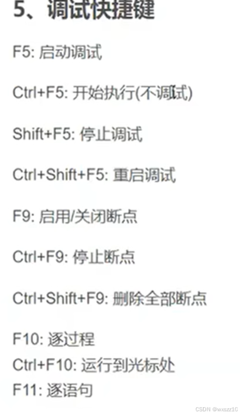

1.算数转换

小的类型向大的提升，例如char、short变成int。

但是int会转换为unsigned（如果是负数，转换后会被认为是很大的整数）

2.算数转换与整型提升的区别

整型提升只适用比整型小的数，3而算数转换是比整型大的数例如longlong、double

3.debug是程序员版本（更适用于调试），release是发布版本（有各种优化，运行更快，大小更小。

4.调试时的断点可以设置条件

5\.

f10与f11的区别在调用函数时才会体现出来，f11会进入调用函数的内部。

---

原文发表于 CSDN：[ 11.5学习记录 ](https://blog.csdn.net/wxszz10/article/details/143500201)，作者：wxszz10。保留原文内容及图片。原文采用 [CC BY-SA 4.0](https://creativecommons.org/licenses/by-sa/4.0/) 协议。
