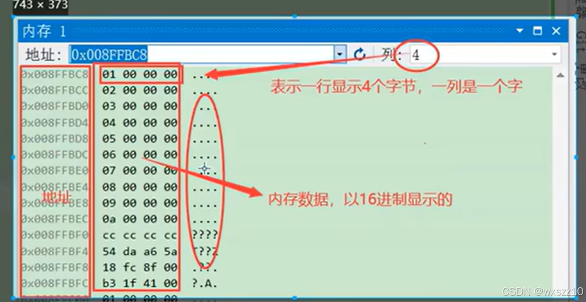
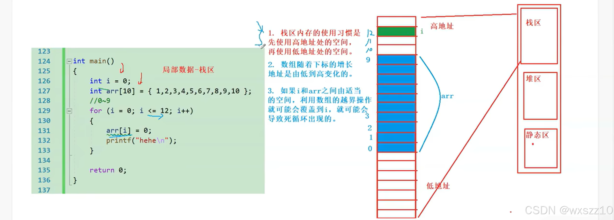

1.自动窗口（自动加载上下的变量）

2.环境变量（但是会随着程序运行改变）有些变量会不在

3.监视：相对来说监视更加准确，甚至合法的表达式也算，可以显示结果

还可以查看内存画圈的部分是编译器识别的里面的东西，....就代表识别不了，？？？是文本

4.调用堆栈：外部代码：可以观察到函数的调用情况，压栈（录入数据）、出栈（清除数据）

5.可以通过反汇编看见语言被转换成什么汇编代码

6.寄存器与栈的部分概念

- **寄存器**是CPU内部的高速存储单元，用于临时存储正在执行的指令、运算结果、地址等信息。由于寄存器位于CPU内部，因此访问速度非常快。
- 常见的寄存器包括程序计数器（PC）、指令寄存器（IR）、通用寄存器（例如：AX、BX、CX等）、堆栈指针寄存器（SP）等。
- **栈**是一种数据结构，通常用来存储函数调用过程中的临时数据（如局部变量、函数返回地址等）。栈是基于“后进先出”（LIFO，Last In First Out）原则的。
- 。寄存器用于高速缓存和运算，数量有限，存储容量也非常小（通常以字节或几十个字节计算）；而栈用于存储函数调用、局部变量等，存储空间较大，可以根据需要扩展，通常在内存（RAM）中占用更多空间。
- 7.
- 很厉害的一个错误，其中10、11的空格由编译器决定

---

原文发表于 CSDN：[ 11.6学习笔记 ](https://blog.csdn.net/wxszz10/article/details/143580570)，作者：wxszz10。保留原文内容及图片。原文采用 [CC BY-SA 4.0](https://creativecommons.org/licenses/by-sa/4.0/) 协议。
