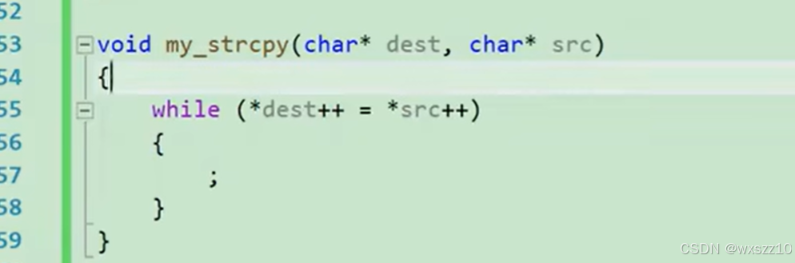
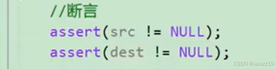
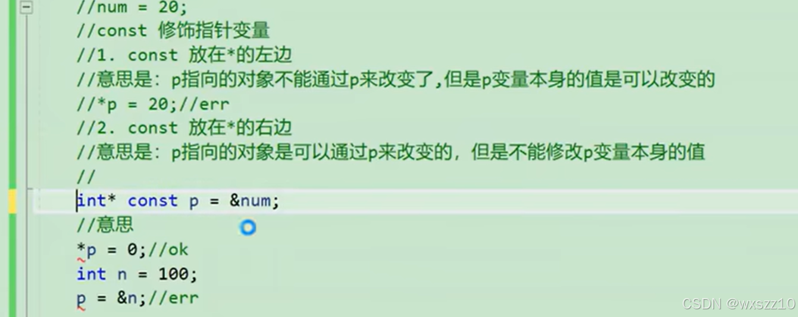
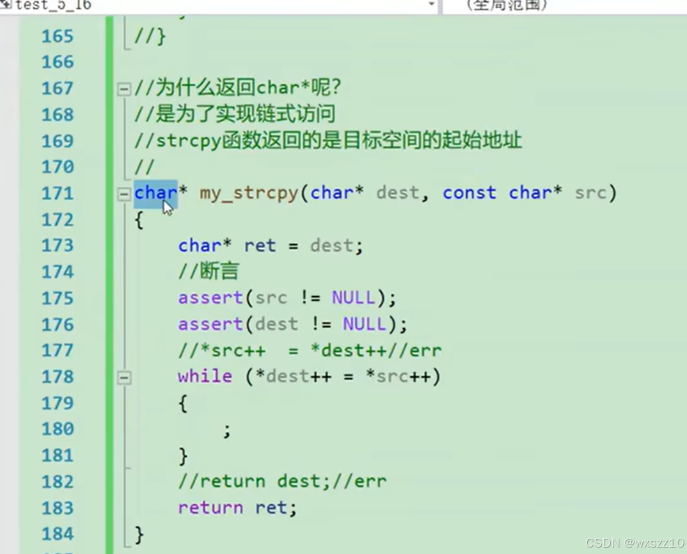
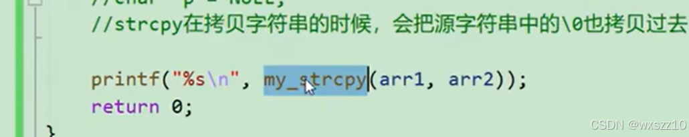

1.strcpy拷贝的时候会把\0也拷贝过去

2.assert是断言

如果不满足框中的表达式会报错

3.关于const

4.函数中char\*的作用

---

原文发表于 CSDN：[ 11.8笔记2 ](https://blog.csdn.net/wxszz10/article/details/143631007)，作者：wxszz10。保留原文内容及图片。原文采用 [CC BY-SA 4.0](https://creativecommons.org/licenses/by-sa/4.0/) 协议。
