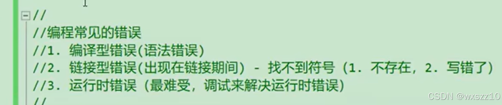
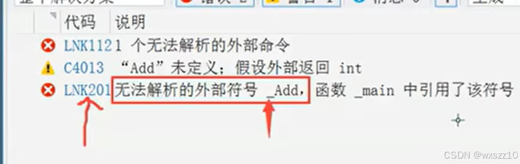

1.不能对NULL进行解应用

2.常见的一些错误

（1）这个较为简单，可通过编译器的报错发现，好更改

（2）这个基本在调用函数时出现，例如：

也比较好解决，加个库就可以了

（3）一般属于程序的逻辑问题，不能完成指定要求，很难发现，通过调试解决

3.这是一个搜索键，迅速找到代码中的指定名称

4.下载git和tortoisegit，前者是一个版本更新的东西，常使用命令来使用，而后者则是辅助其使用，公司经常使用

---

原文发表于 CSDN：[ 11.9学习笔记 ](https://blog.csdn.net/wxszz10/article/details/143639323)，作者：wxszz10。保留原文内容及图片。原文采用 [CC BY-SA 4.0](https://creativecommons.org/licenses/by-sa/4.0/) 协议。
