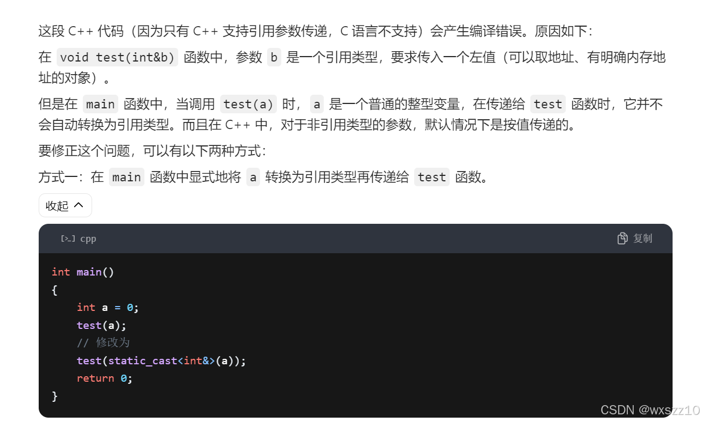

一.对于字符串的浅显理解：存储字符串有2种方法：

1.用数组来存储，char arr[]="字符串"；这样的形式，优点易于更改，缺点格式麻烦，而且涉及了很多知识，例如数组就代表其首元素地址，相当于已经赋值了的指针变量。但是不能用char\* arr来代替arr来进行存储，因为char\* arr只是一个指向数组的指针，而并不具有存储字符功能，存储的只是数组地址，只是说数组名有相当于指针的功能。

注意：不能用char a=“字符串”；这样的形式来存储字符串，因为char就决定了只能存储单字符

二.char(\*chs)与char\* chs的区别

前者是用来指向一维数组的指针，后者则是用来指向二维数组的指针，每加一次就到下一个数组。

三、int &a,

这是引用，与传地址形式不同，但是都能改变原变量的值，但在c语言中无法使用，是c++等其他语言的方法

四、全局与局部变量

局部变量存储在栈区，全局变量存储在全局数据区。

---

原文发表于 CSDN：[ 11.11学习笔记 ](https://blog.csdn.net/wxszz10/article/details/143680737)，作者：wxszz10。保留原文内容及图片。原文采用 [CC BY-SA 4.0](https://creativecommons.org/licenses/by-sa/4.0/) 协议。
