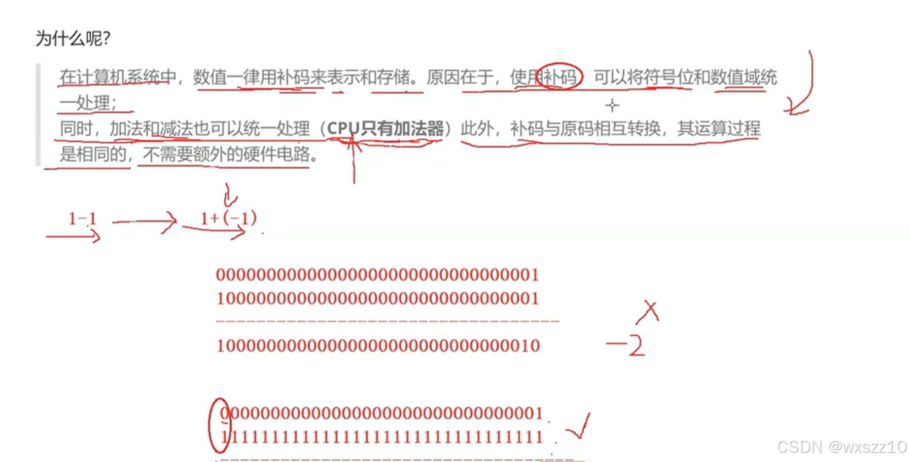
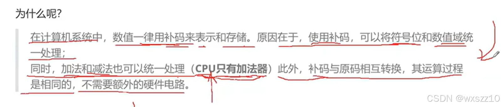
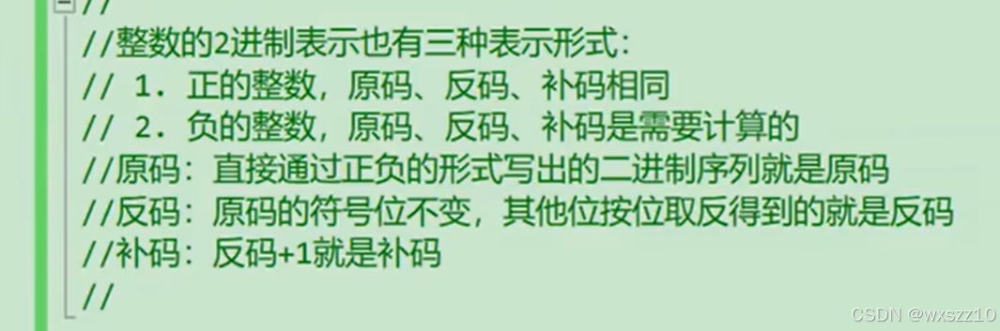
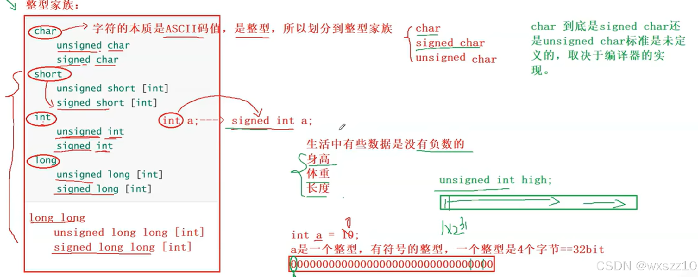

1.原码反码补码存在的原因，由于cpu只有加法器，为了能进行减法，于是设计了三码2.三码之间的互换规则3.整型大家族，unsigned存在的意义就是来存储那些不存在负数的值

---

原文发表于 CSDN：[ 11.14学习笔记 ](https://blog.csdn.net/wxszz10/article/details/143758709)，作者：wxszz10。保留原文内容及图片。原文采用 [CC BY-SA 4.0](https://creativecommons.org/licenses/by-sa/4.0/) 协议。
