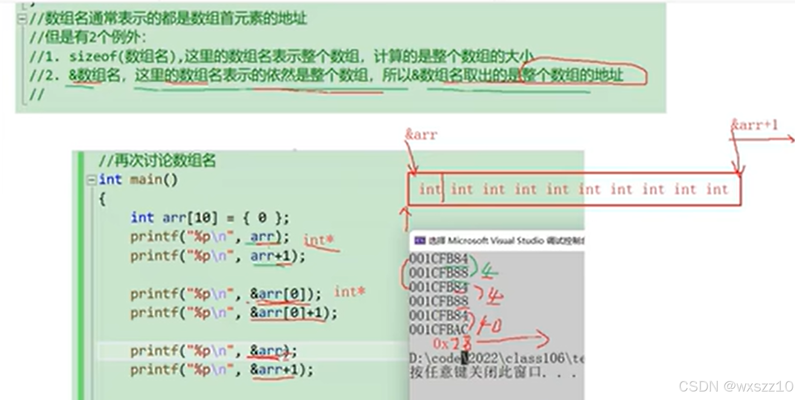
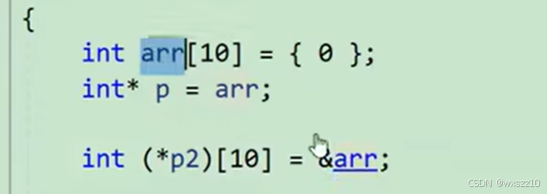
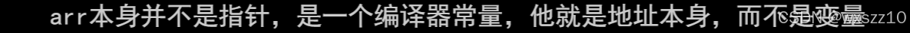
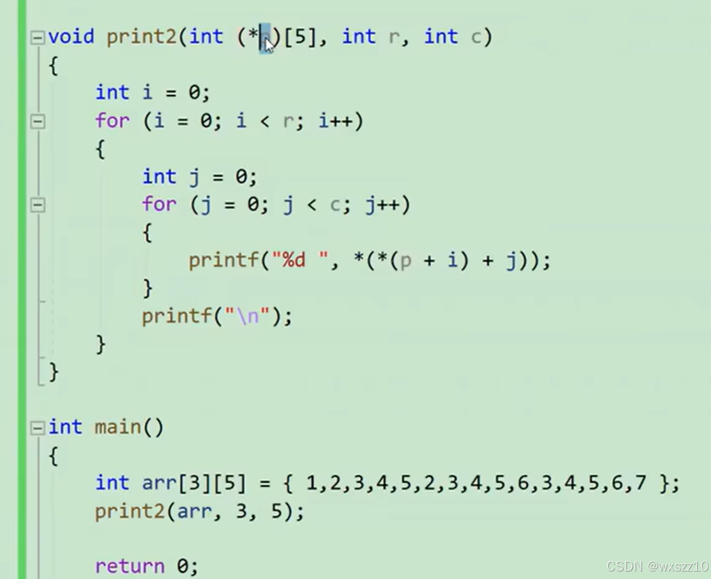
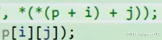

1.这个就是关于数组名的特殊应用，其与后面的数组指针有很大关系

2.这个就是数组指针的一个简单应用，得到的是整个数组的地址

tip：

所以貌似和数组指针没有区别，但是实质上的区别在这

3.\*(p+i)这个相当于得到第i行的首元素地址，\*(\*(p+i)+j)得到就是第i行第j个的元素

4.

这两个实际上是等价的，相同意义

---

原文发表于 CSDN：[ 11.21学习笔记 ](https://blog.csdn.net/wxszz10/article/details/143932697)，作者：wxszz10。保留原文内容及图片。原文采用 [CC BY-SA 4.0](https://creativecommons.org/licenses/by-sa/4.0/) 协议。
