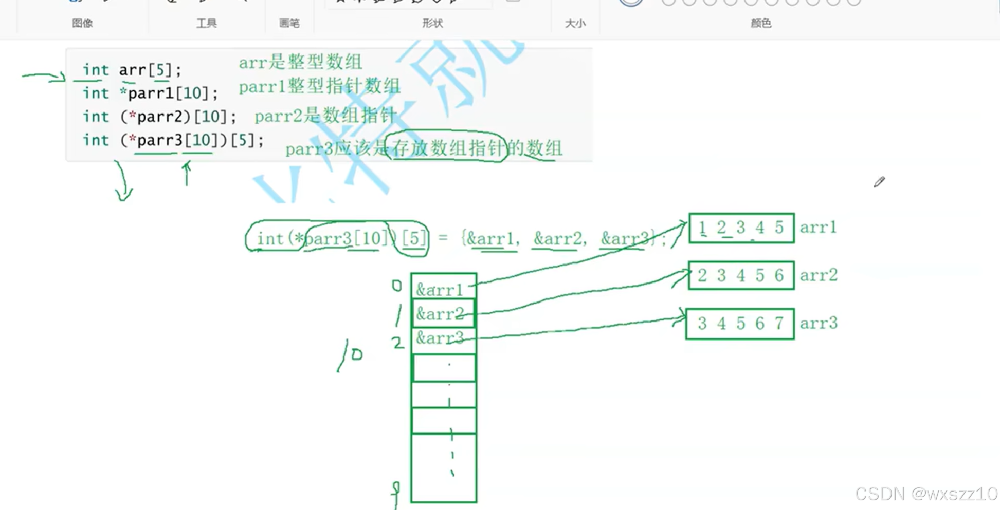
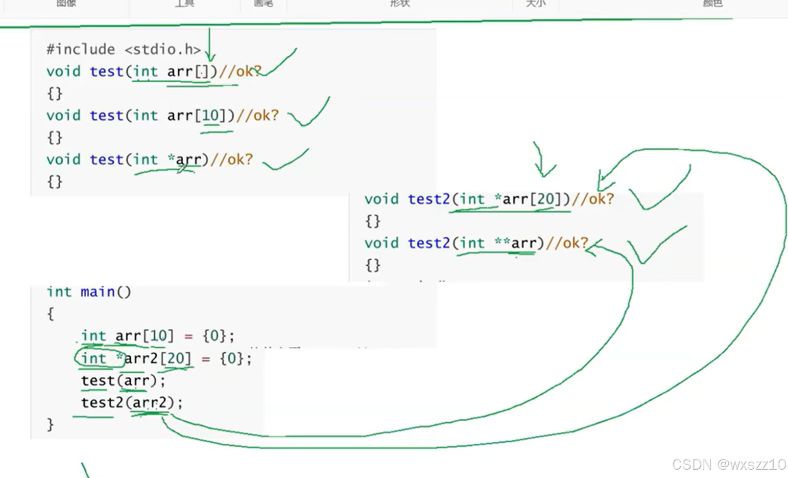
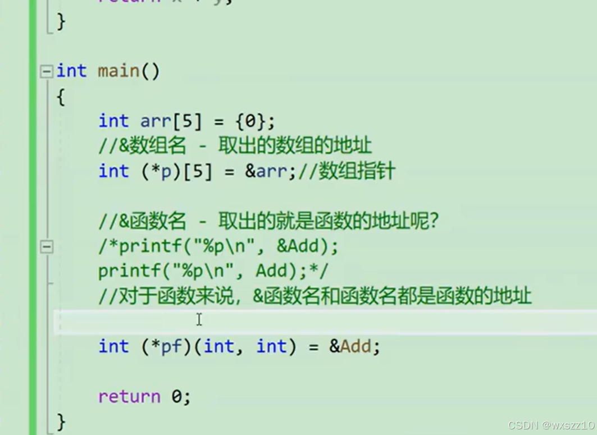

1.

这是一个易混点，其中第二个和第三个非常容易搞混，要搞清楚这两个，就要明白指针的格式，

（int）\*(arr)(   )；第一个括号指的是地址中所指向的空间中所装的数据类型，第二个括号则是变量名，第三个括号则是可有可无的，这个要看具体要创造的变量类型。

例如第二个实际上是（int)\*(parr1[10])这样的，也就是创造了一个数组，有十个元素，元素都是指针。其实可以与创造数组的形式来比较，int arr[10],这就是创造数组，但是里面是指针，所以加上\*，这样更好理解。

第三个则是先创造一个指针变量，然后int[10]是他的类型，所以他是指向数组的指针。

而第四个，则是前两者的结合体，首先创造了一个指针数组，可以放十个元素，然后int[5]告诉我们元素是数组指针，这个数组能放五个元素。

2. 

这个是对于传参的一个解释，数组作为实参，有多种接收方式，但要注意指针数组可以通过二级指针来接受，不能用一级指针。

3.这个则是函数指针，挺好玩的，下面是应用实例

这int是函数的返回值类型，第一个括号是变量名，第二个是形参类型。

这可以帮助理解指针数组，其实指针的创建，都要遵循其地址所指向的内容的创建形式，

比如int(\*p)[10]这是一个数组指针，和数组的创建方式很像，而函数也是

int add(int x,int y)这是函数的创建。而函数指针则是int (\*p)(int,int)，十分相似。

如有不对，见谅。

---

原文发表于 CSDN：[ 11.23学习笔记 ](https://blog.csdn.net/wxszz10/article/details/143990321)，作者：wxszz10。保留原文内容及图片。原文采用 [CC BY-SA 4.0](https://creativecommons.org/licenses/by-sa/4.0/) 协议。
