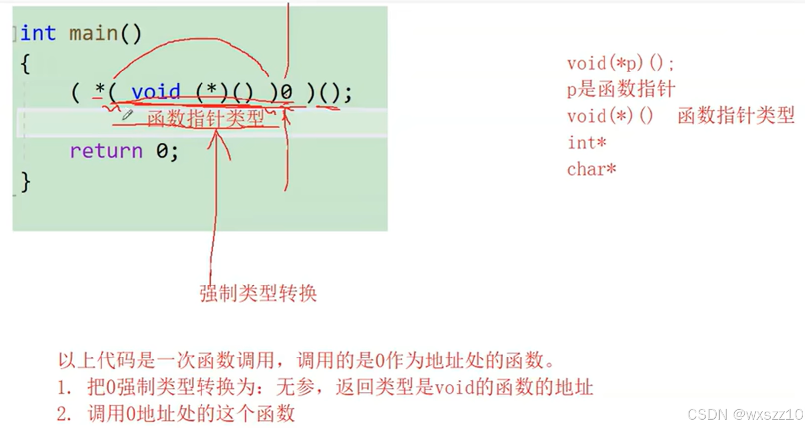
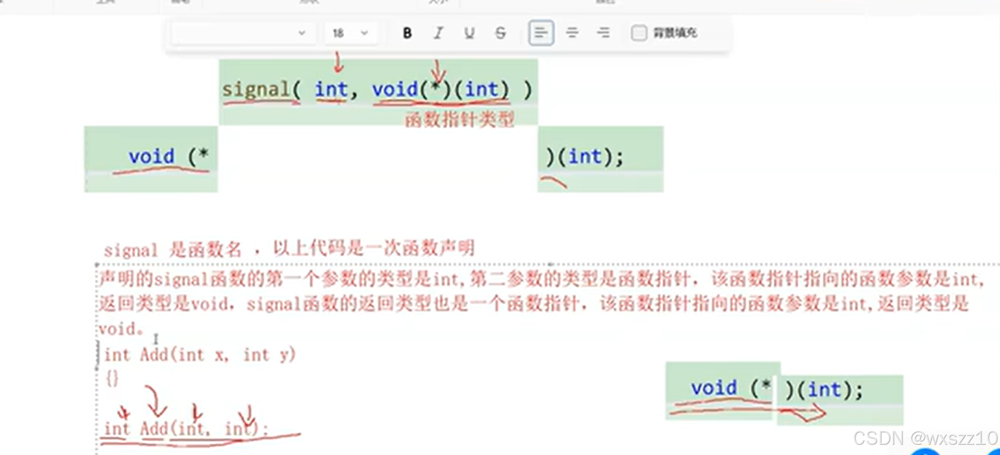

1\.

这是一个很有意思的实例，其实考察了对于函数指针格式的理解，还涉及到了类型转换，

首先,\*(void)(\*)()这个就是函数指针的类型，然后将0由int转换为函数指针的类型，然后配合后面的括号，意味着调用地址为0x00000的函数。

2\.

这是第二个例子，题目是void(\*signal(int,void(\*)(int) ) ) (int),一下让人很懵，先看内层，首先

声明了函数signal，然后外层是一个函数指针，也就是说，signal函数的返回类型是函数指针，很好玩

---

原文发表于 CSDN：[ 11.24学习笔记 ](https://blog.csdn.net/wxszz10/article/details/144014895)，作者：wxszz10。保留原文内容及图片。原文采用 [CC BY-SA 4.0](https://creativecommons.org/licenses/by-sa/4.0/) 协议。
