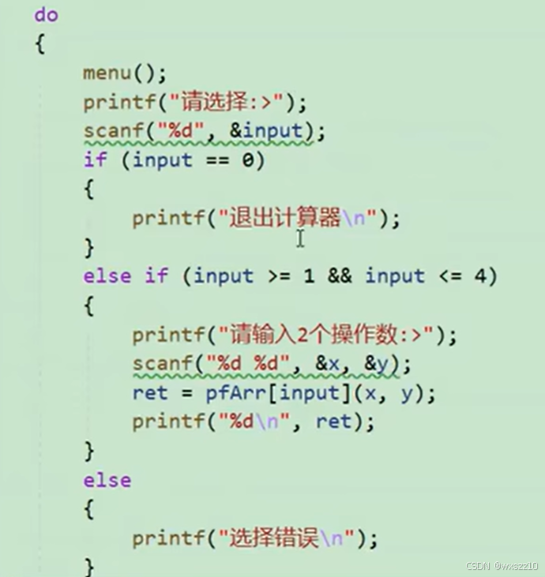
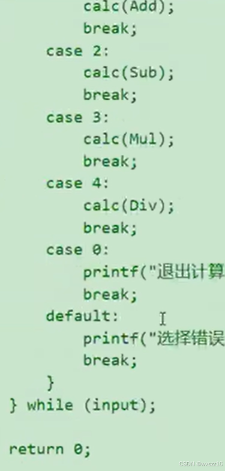
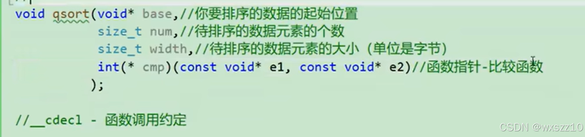

1.举一个例子，来体现函数指针数组的便利，这是化简后的版本，这是之前的版本

仅仅是一部分，就和化简后的代码一样长

2.这是对快速排序函数qsort的解析，比较有意思的是最后一个参数，要自己制定一个比较规则函数作为参数传入。

---

原文发表于 CSDN：[ 11.25学习笔记 ](https://blog.csdn.net/wxszz10/article/details/144030139)，作者：wxszz10。保留原文内容及图片。原文采用 [CC BY-SA 4.0](https://creativecommons.org/licenses/by-sa/4.0/) 协议。
