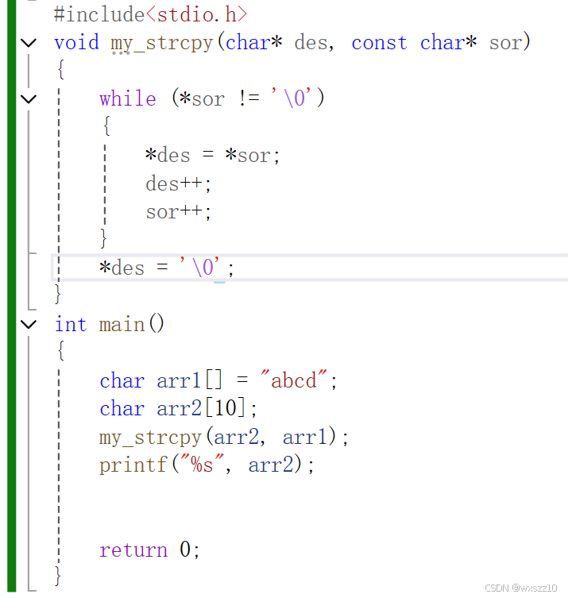
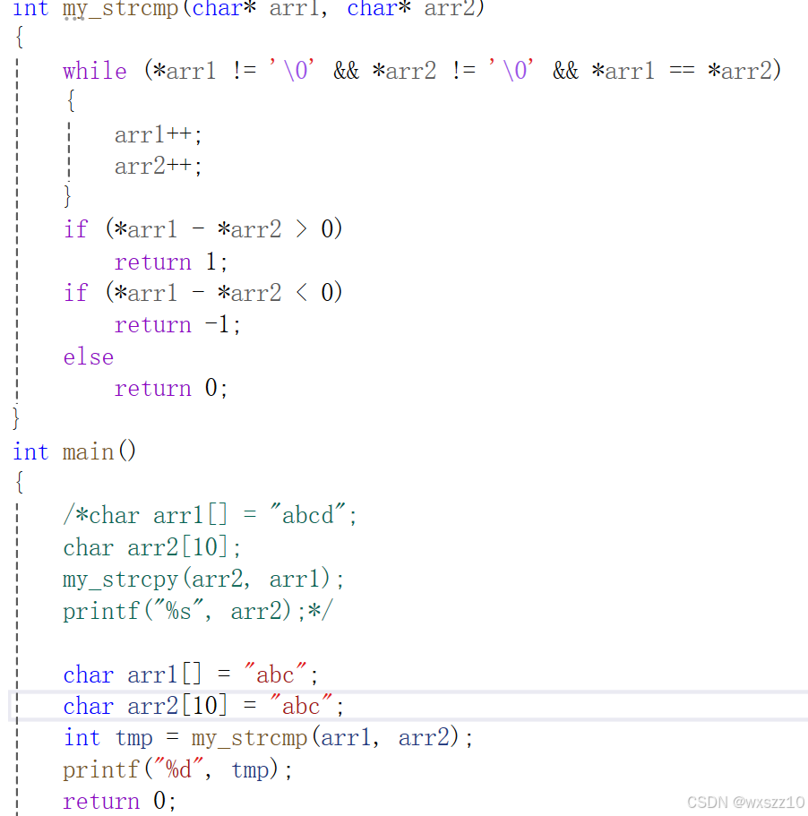
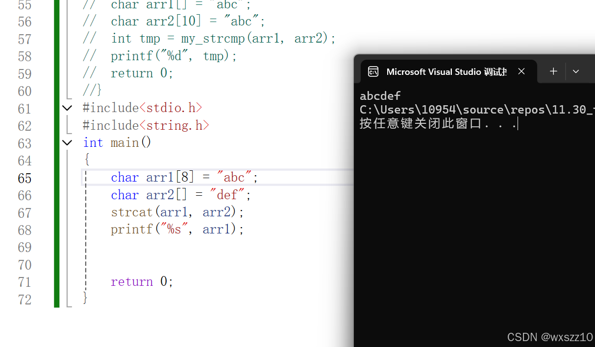

今天学了几个关于字符的函数：

1.strcpy，这是一个比较常用的函数，，用来复制字符串，以下是他的源代码以及应用

2.strcmp：用来比较两个字符串的大小，这是具体的实现过程

3.strcat:这是一个接着复制的字符串，以下是使用方法及结果

---

原文发表于 CSDN：[ 11.30学习笔记 ](https://blog.csdn.net/wxszz10/article/details/144102544)，作者：wxszz10。保留原文内容及图片。原文采用 [CC BY-SA 4.0](https://creativecommons.org/licenses/by-sa/4.0/) 协议。
