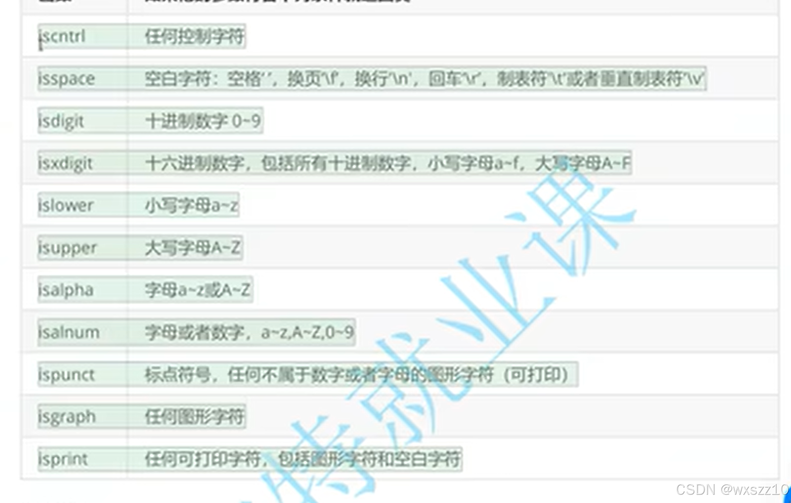
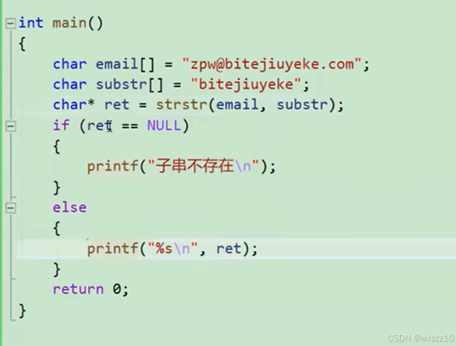
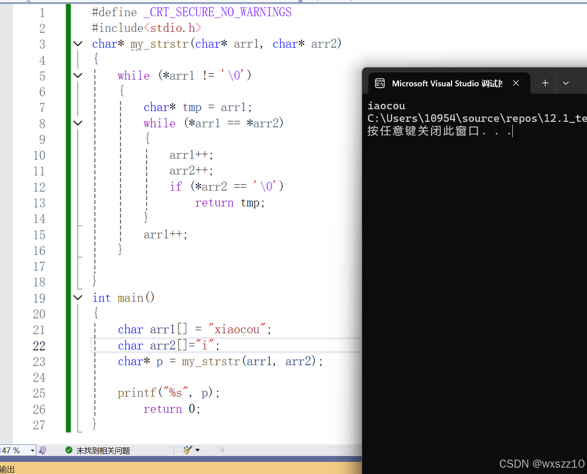
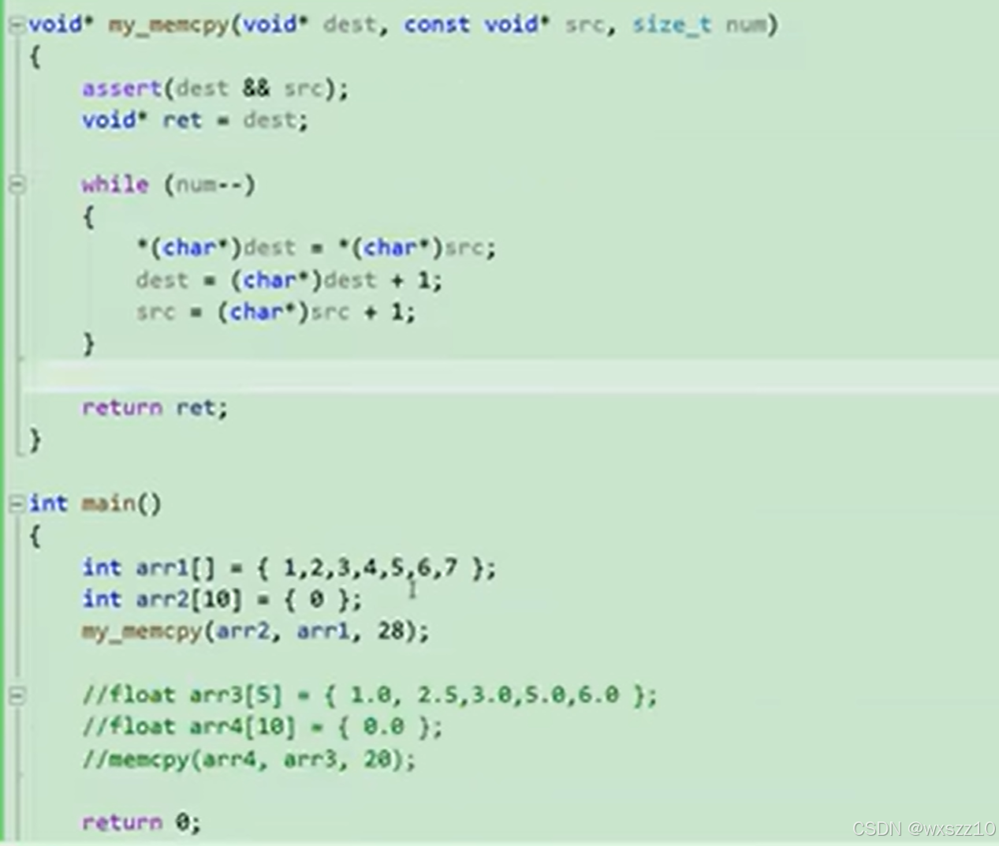

1.这是一个判断字符的一个函数，是就返回正数，不是就返回0.2.这一个较为重要的函数，查找功能，email作为被查找数组，substr作为要找的字符串，若Email中存在substr，则返回返回substr在email中出现的起始地址，如下图会输出bitejiuyeke.com这一串字符。第二张图是模拟实现的代码及结果。

3.这是一个memcpy模拟实现的写法，memcpy局势根据后面给的字节数来将arr1中的字符复制到arr1中，20指的是字节数。

---

原文发表于 CSDN：[ 12.1学习笔记 ](https://blog.csdn.net/wxszz10/article/details/144166867)，作者：wxszz10。保留原文内容及图片。原文采用 [CC BY-SA 4.0](https://creativecommons.org/licenses/by-sa/4.0/) 协议。
