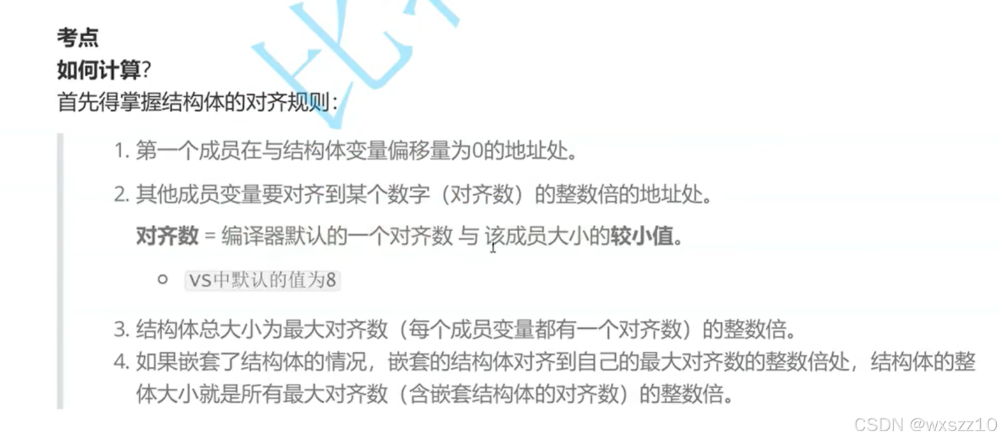
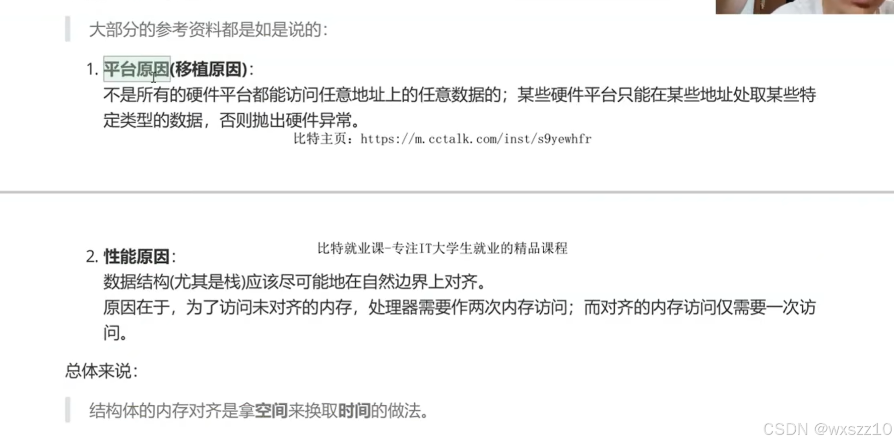
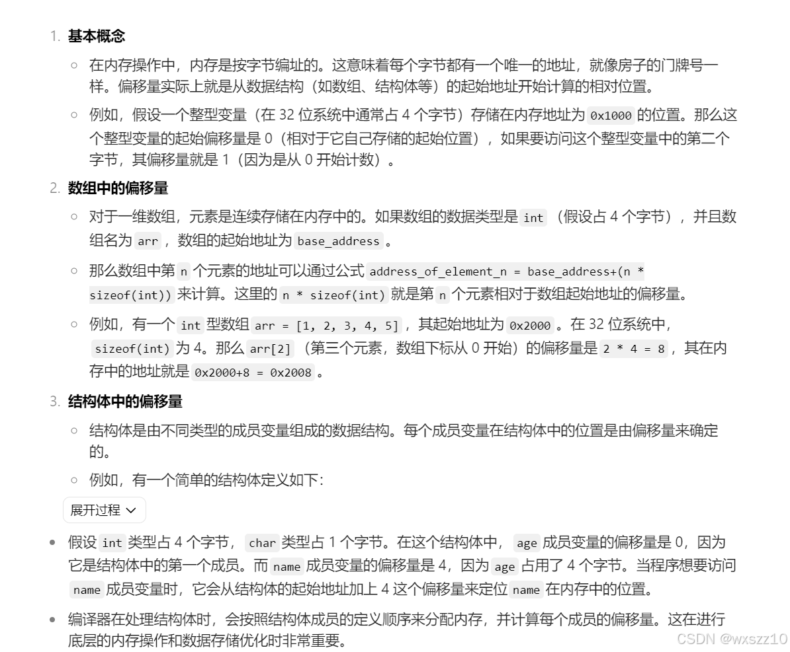
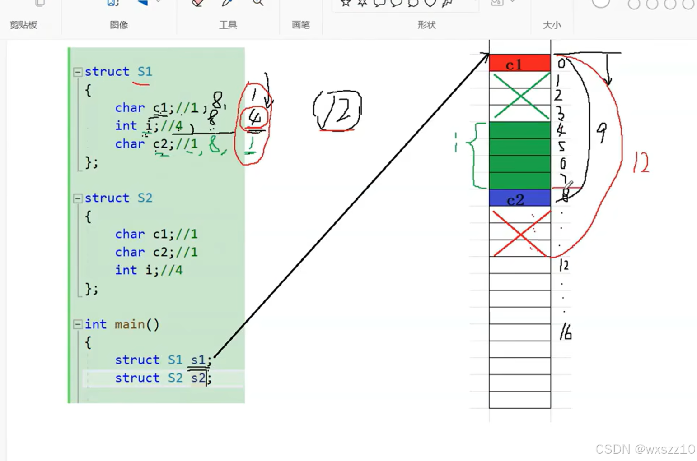
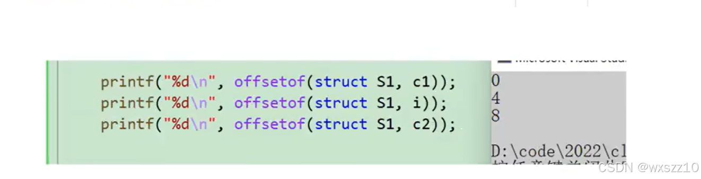
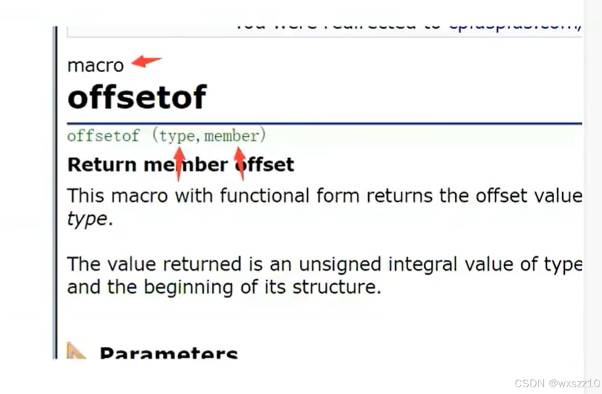

1.来介绍一下结构体的一个存储规则，这个规则看着很无理，莫名其妙的制定规则让存储很难，但是实际上是为了更好读取，也就是用空间换时间，

这就是解释的具体原因

下面是具体例子

解析：先引入一个新概念，

偏移量，这是对偏移量的简单解释，简单说就是元素首地址与结构体首地址之间相差的字节数

根据规则，先将从c1存入结构体偏移量为0的地址，，然后开始存储第二个int数据，vs对齐数默认为8，int大小为4字节，所以取4，所以int要对齐到地址为4的倍数的地址开始存储，从第四个开始存储，然后开始存储char，对齐数取1，任何数都是1的倍数，所以接在int后面存储，到这元素存储完毕，现在大小为9字节，而结构体大小要是最大对齐数的整数倍，最大对齐数为4，所以结构体大小为12.

这是测试结果

其中，offsetof是用来测偏移量的，具体如下

---

原文发表于 CSDN：[ 12.7学习笔记 ](https://blog.csdn.net/wxszz10/article/details/144305203)，作者：wxszz10。保留原文内容及图片。原文采用 [CC BY-SA 4.0](https://creativecommons.org/licenses/by-sa/4.0/) 协议。
