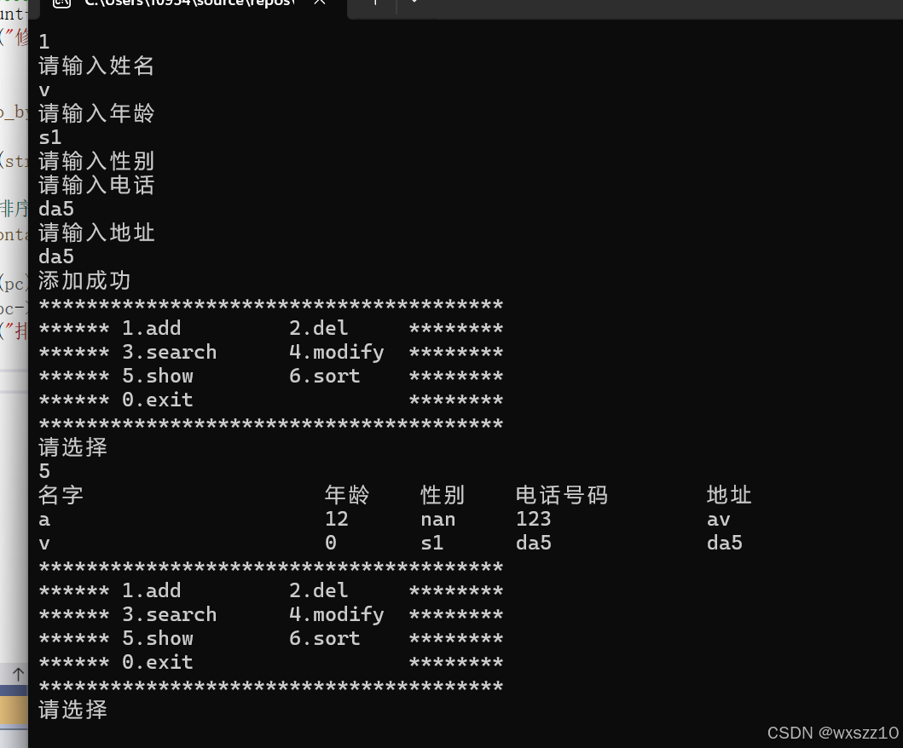
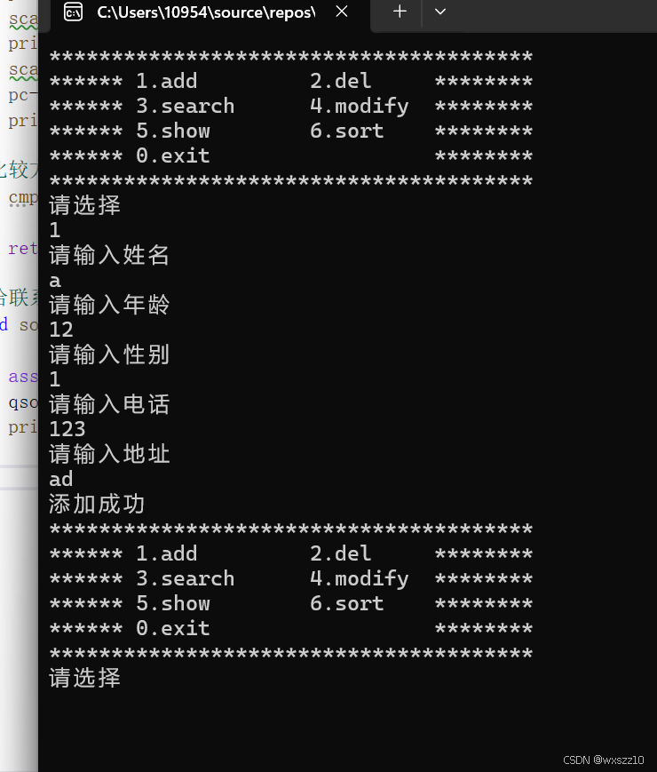
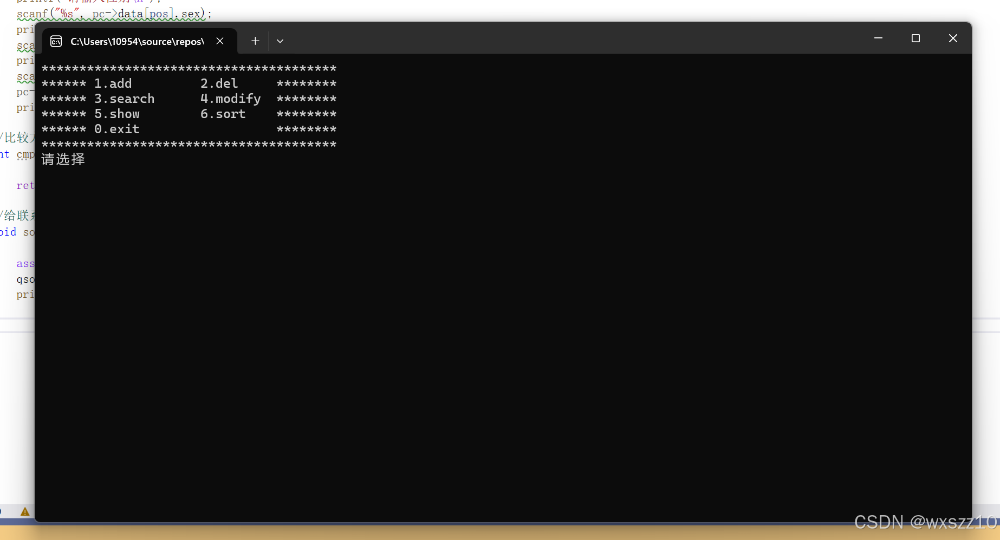

1.目录

```
#define _CRT_SECURE_NO_WARNINGS
#include<stdio.h>
#include<string.h> 
#include<assert.h>
#define max 100
#define max_name 20
#define max_sex 10
#define max_tele 12
#define max_addr 30
```

```
typedef struct peoinfor
{
    char name[max_name];
    int age;
    char sex[max_sex];
    char tele[max_tele];
    char addr[max_addr];
```

```
}peoinfor;
```

```
typedef struct contact
//这两信息放在一起更好处理
{
    peoinfor data[max];//存放人的信息
    int count;//人数
}contact;
//初始化
void initcontact(contact* pc);
//添加联系人
void addcontact(contact* pc);
//展示通讯录
void showcontact(contact* pc);
//删除联系人
void delcontact(contact* pc);
//查找联系人
void findcontact(contact* pc);
//修改联系人
void modifycontact(contact* pc);
//给联系人排序
void sortcontact(contact* pc);
2.主程序
```

```
#define _CRT_SECURE_NO_WARNINGS
#include"contact.h"
void menu()
{
    printf("***************************************\n");
    printf("****** 1.add         2.del     ********\n");
    printf("****** 3.search      4.modify  ********\n");
    printf("****** 5.show        6.sort    ********\n");
    printf("****** 0.exit                  ********\n");
    printf("***************************************\n");
```

```
}
int main()
{
    int input = 0;
    contact con;
    initcontact(&con);
    do 
    {
         menu();
        printf("请选择\n");
        scanf("%d", &input);
        switch (input)
        {
        case 1:
            addcontact(&con);
                break;
        case 2:
            delcontact(&con);
            break; 
        case 3:
            findcontact(&con);
            break;
        case 4:
            modifycontact(&con);
            break;
        case 5:
            showcontact(&con);
            break;
        case 6:
            sortcontact(&con);
            break;
        case 0:
            printf("退出通讯录\n");
            break;
        default:
            printf("选择错误\n");
```

```
        }
    } while (input);
```

```
    return 0;
}
```

3.实现程序

```
#define _CRT_SECURE_NO_WARNINGS
#include "contact.h"
//初始化通讯录
void initcontact(contact* pc)
{
    assert(pc);
    pc->count = 0;
    //这一步是将data里面所有的数据初始化为0，单位为字节
    memset(pc->data, 0, sizeof(pc->data));
}
//添加联系人
void addcontact(contact* pc)
{
    assert(pc);
    //判断通讯录是否满了
    if (pc->count == max)
    {
        printf("人数已满，无法添加\n");
    }
    // 输入数据 
    printf("请输入姓名\n");
    scanf("%s", pc->data[pc->count].name);
    printf("请输入年龄\n");
    scanf("%d", &(pc->data[pc->count].age));
    printf("请输入性别\n");
    scanf("%s", pc->data[pc->count].sex);
    printf("请输入电话\n");
    scanf("%s", pc->data[pc->count].tele);
    printf("请输入地址\n");
    scanf("%s", pc->data[pc->count].addr);
    pc->count++;
    printf("添加成功\n");
```

```
}
//展示联系人
void showcontact(contact* pc)
{
    assert(pc); 
    int i = 0;
    printf("%-20s\t%-5s\t%-5s\t%-12s\t%-30s\n", "名字", "年龄", "性别", "电话号码", "地址");
    for (i = 0; i < pc->count; i++)
    {
        printf("%-20s\t%-5d\t%-5s\t%-12s\t%-30s\n"   ,pc->data[i].name
                                                ,pc->data[i].age
                                                ,pc->data[i].sex
                                                ,pc->data[i].tele
                                                ,pc->data[i].addr);
    }
}
//删除联系人
void delcontact(contact* pc)
{
    //判断pc是否有效
    assert(pc);
    //pc中是否有数据
    if (pc->count == 0)
    {
        printf("通讯录为空，不可删除\n");
    }
    //开始删除
    char name[max_name] = { 0 };
    printf("请输入被删除人的名字\n");
    scanf("%s", name);
    //1.查找
    int pos=findbyname(pc, name);
    if (pos==-1)
    {
        printf("不存在此人\n");
        return;
    }
    //2.删除
    int i = 0;
    for (i = pos; i < pc->count-1; i++)
    {
        pc->data[i] = pc->data[i + 1];
    }
    pc->count--;
    printf("删除成功\n");
}
//查找
static int findbyname(contact* pc, char name[])
{
    int i = 0;
    for (i = 0; i < pc->count; i++)
    {
        if (strcmp(pc->data[i].name, name) == 0)
        {
            return i;
        }
    }
    return -1;
}
//查找联系人
void findcontact(contact* pc)
{
    //判断pc是否有效
    assert(pc);
    //pc中是否有数据
    if (pc->count == 0)
    {
        printf("通讯录为空，不可查找\n");
    }
    //1.查找
    char name[max_name] = { 0 };
    printf("请输入被查找人的名字\n");
    scanf("%s", name);
    int pos = findbyname(pc, name);
    
    if (pos==-1)
    {
        printf("不存在此人\n");
        return;
    }
    //输出信息
    printf("%-20s\t%-5s\t%-5s\t%-12s\t%-30s\n", "名字", "年龄", "性别", "电话号码", "地址");
    printf("%-20s\t%-5d\t%-5s\t%-12s\t%-30s\n", pc->data[pos].name
        , pc->data[pos].age
        , pc->data[pos].sex
        , pc->data[pos].tele
        , pc->data[pos].addr);
}
//修改联系人
void modifycontact(contact* pc)
{
    //判断pc是否有效
    assert(pc);
    //pc中是否有数据
    if (pc->count == 0)
    {
        printf("通讯录为空，不可查找\n");
    }
    //1.查找
    char name[max_name] = { 0 };
    printf("请输入被查找人的名字\n");
    scanf("%s", name);
    int pos = findbyname(pc, name);
```

```
    if (pos == -1)
    {
        printf("不存在此人\n");
        return;
    }
    printf("已找到修改人信息，开始修改\n");
    //开始修改
    printf("请输入姓名\n");
    scanf("%s", pc->data[pos].name);
    printf("请输入年龄\n");
    scanf("%d", &(pc->data[pos].age));
    printf("请输入性别\n");
    scanf("%s", pc->data[pos].sex);
    printf("请输入电话\n");
    scanf("%s", pc->data[pos].tele);
    printf("请输入地址\n");
    scanf("%s", pc->data[pos].addr);
    pc->count++;
    printf("修改成功\n");
}
//比较方法
int cmp_peo_by_name(const void* e1, const void* e2)
{
    return(strcmp(((peoinfor*)e1)->name, ((peoinfor*)e2)->name));
}
//给联系人排序（按照名字）
void sortcontact(contact* pc)
{
    assert(pc);
    qsort(pc->data, pc->count, sizeof(peoinfor), cmp_peo_by_name);
    printf("排序成功\n");
}
4.实现图片
```







---

原文发表于 CSDN：[ 通讯录的简单实现 ](https://blog.csdn.net/wxszz10/article/details/144369124)，作者：wxszz10。保留原文内容及图片。原文采用 [CC BY-SA 4.0](https://creativecommons.org/licenses/by-sa/4.0/) 协议。
