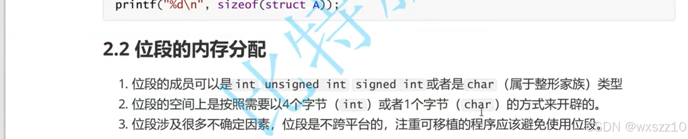
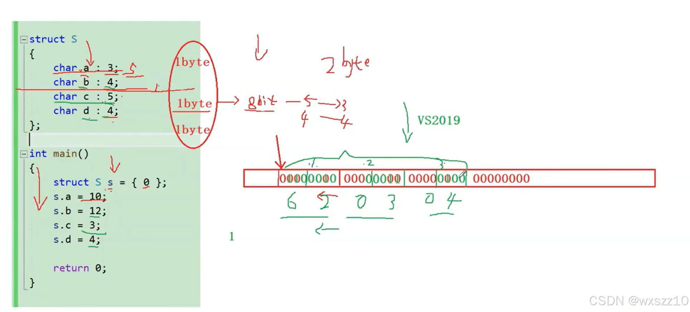
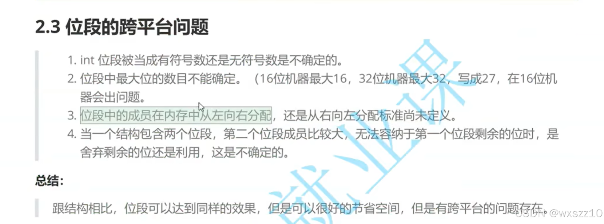

1.概念

位段（bit - field）是一种数据结构。它允许在一个字节（或多个字节）中按位划分来存储不同的数据成员。

2.用法

这个就是用来节省空间的，但是不具有跨平台性，慎用。

3.实例

首先系统会先开辟一个字节的空间（一个字节=8bit），a后面的单位是bit，因为a+b&lt;7，所以他们共用一个字节的空间，还剩一个bit，但是接下来的c大于一个bit，所以会新开辟一个字节来存储c，且上一个多出来的bit不会利用。

3.小tip：

---

原文发表于 CSDN：[ 位段的简单理解 ](https://blog.csdn.net/wxszz10/article/details/144443365)，作者：wxszz10。保留原文内容及图片。原文采用 [CC BY-SA 4.0](https://creativecommons.org/licenses/by-sa/4.0/) 协议。
