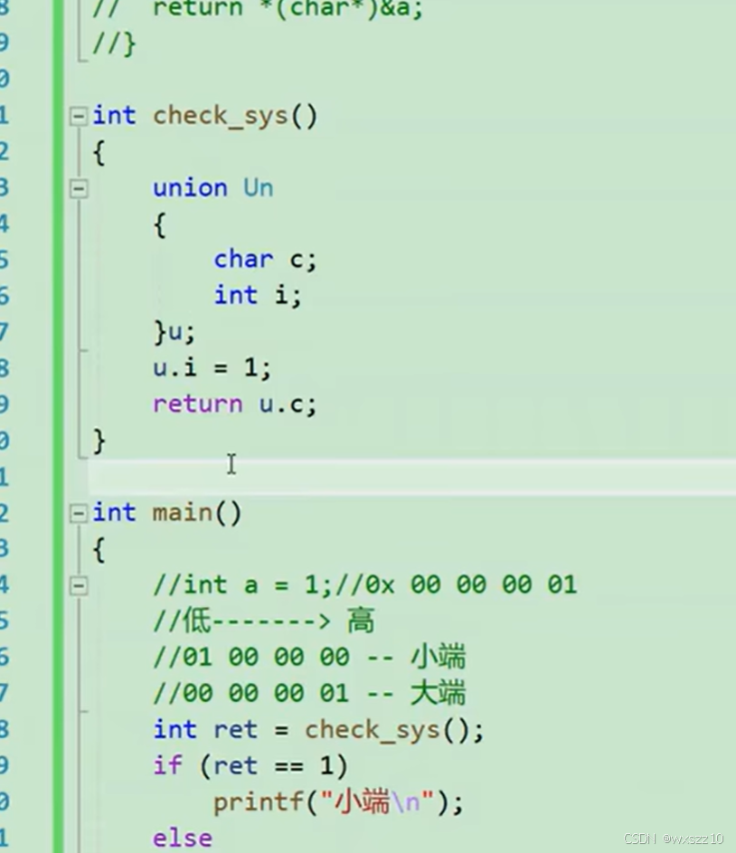
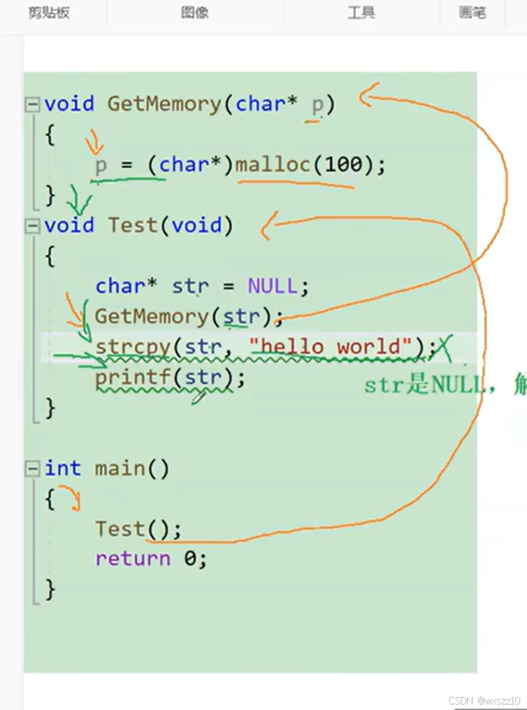
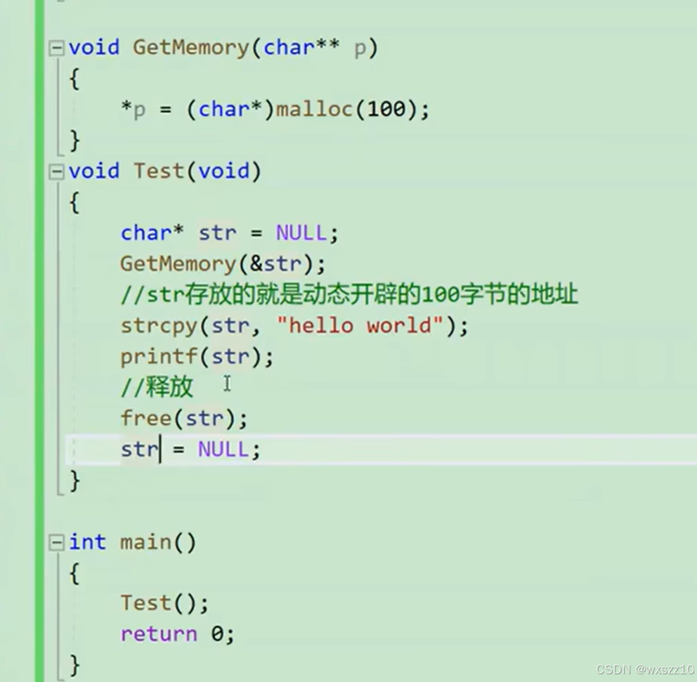
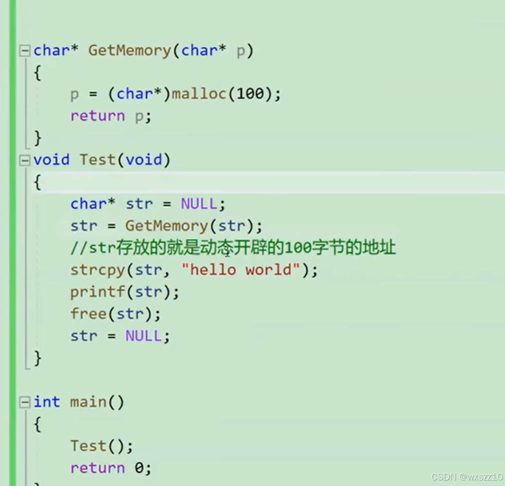
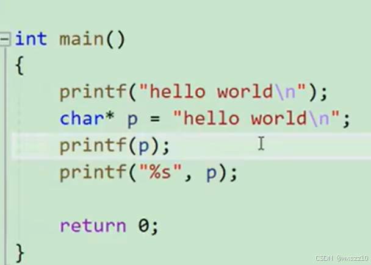
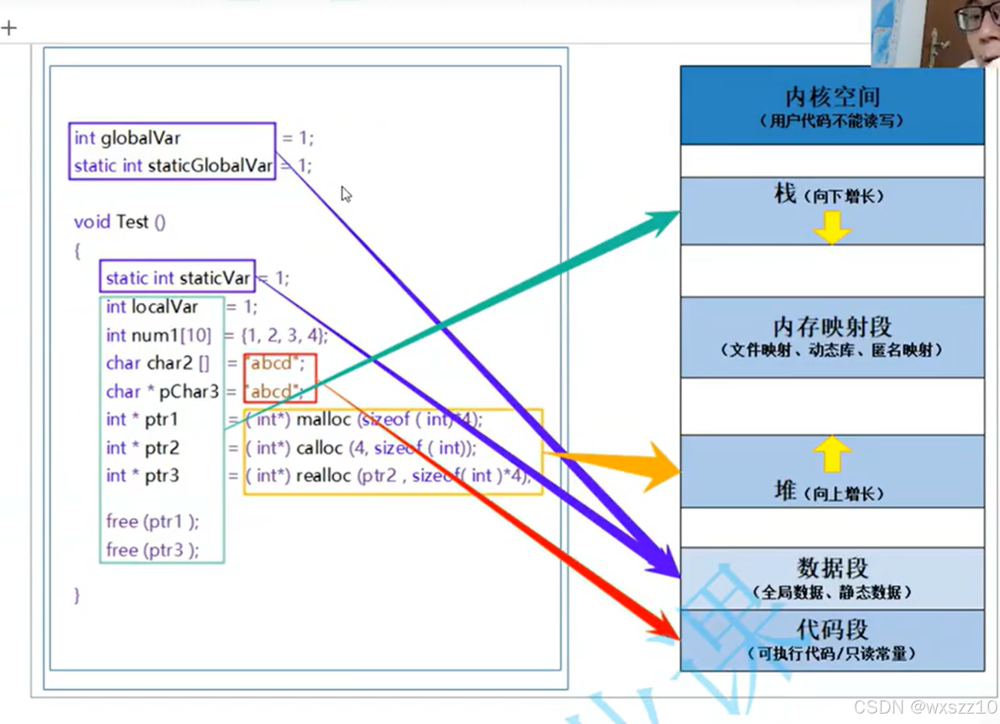

1.联合体：联合体是 C 语言中的一种自定义数据类型，它的主要特点是其所有成员共享同一段内存空间。这与结构体（struct）不同，结构体的每个成员都有自己独立的内存空间。

其优点如下：

- **内存高效利用**：在程序中，当一组数据在不同时刻只需要使用其中一个成员时，联合体就体现出了它的优势。例如，考虑一个简单的设备状态数据结构，它可能需要记录设备的温度（以浮点数形式）或者设备的错误代码（以整数形式）。

- **与结构体配合构建复杂数据结构**：联合体可以和结构体一起构建复杂的数据结构，以适应多种情况。例如，在图形处理程序中，图形对象的数据可能有多种形式。

这是实例应用，用来判断编译器的大小端，

char是一个字节，int是四个字节，然后返回char就是得到int存储第一个字节，根据第一个字节就可以判断大小端，从低地址开始访问，小端就是低位放在低地址，高位放在高地址。

2.这是一个经典错误

解析：这个函数创造的是局部变量，对于str没有影响，所以无法实现需要功能，下面是修改代码

3.对于printf的进一步理解：

打印字符串时，实际上给printf传的参数是首位地址，所以直接打印p也是成立的。

4.内存：

---

原文发表于 CSDN：[ 12.16学习笔记 ](https://blog.csdn.net/wxszz10/article/details/144504721)，作者：wxszz10。保留原文内容及图片。原文采用 [CC BY-SA 4.0](https://creativecommons.org/licenses/by-sa/4.0/) 协议。
