xxdd

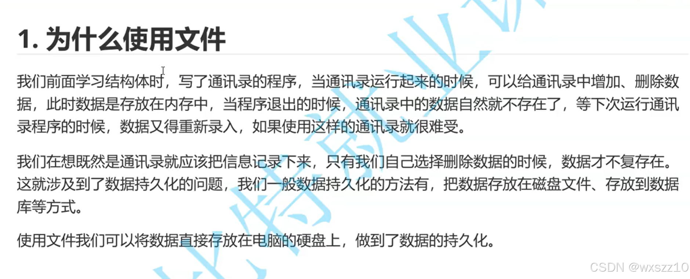1.fopen：打开文件

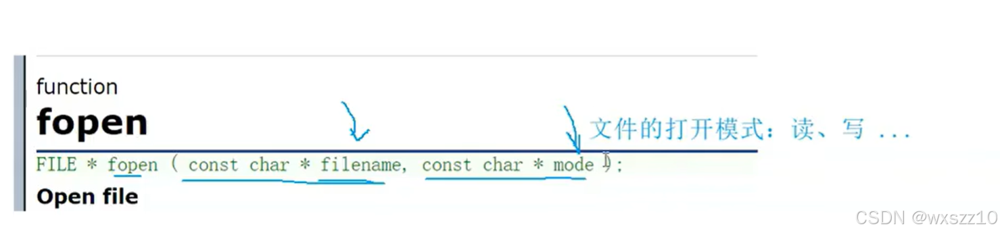第一个参数是打开的文件名称，第二个是打开模式。

2\.

文件打开模式：

（1）.r：

当以`r`模式打开文件时，程序期望该文件已经存在。如果文件不存在，`fopen`函数将返回`NULL`。

这种模式用于从文件中读取数据。例如，读取一个文本文件中的字符、字符串或者格式化的数据。

示例代码如下：#include &lt;stdio.h&gt;

- int main()
  - {
  - FILE \*fp;
  - char buffer[100];
  - fp = fopen("input.txt", "r");
  - if(fp == NULL)
  - {
  - perror("Error opening file");
  - return 1;
  - }
  - fgets(buffer, sizeof(buffer), fp);
  - printf("%s", buffer); fclose(fp);
  - return 0;
  - }
  - (2) w:
  - 以`w`模式打开文件时，如果文件已经存在，文件的内容会被清空；如果文件不存在，则会创建一个新的文件。
  - 主要用于向文件中写入数据。例如，将程序的输出结果保存到文件中。  
    #include &lt;stdio.h&gt;
  - int main()
  - {
  - FILE \*fp; fp = fopen("output.txt", "w");
  - if(fp == NULL) { perror("Error opening file");
  - return 1; } fprintf(fp, "This is a test output.\n");
  - fclose(fp);
  - return 0;
  - }
  - (3)a:
  - 当以`a`模式打开文件时，如果文件已经存在，新的数据会被追加到文件的末尾；如果文件不存在，则会创建一个新文件。
  - 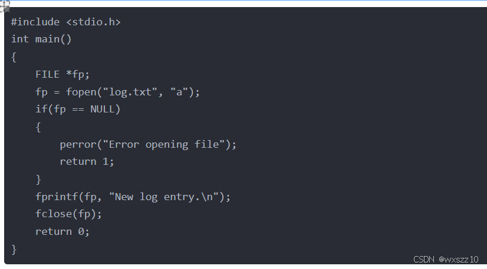
  - **还有这些模式（`r +`、`w +`、`a +）`**
  - **`2.接下来是读取文件内容的例子`**
  - 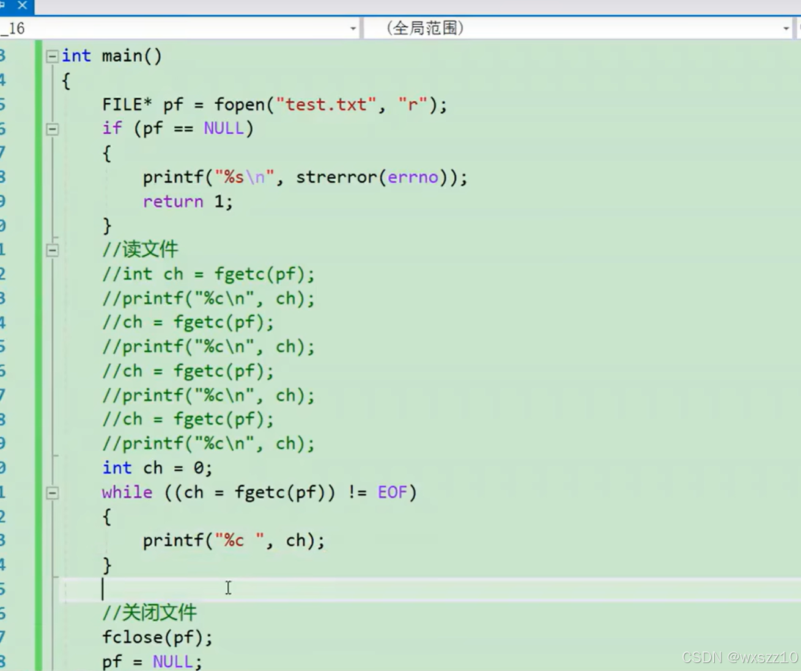
  - 这是用r模式打开文件进行读取，每读取一次文件指针会向下一个元素的位置移动
  - 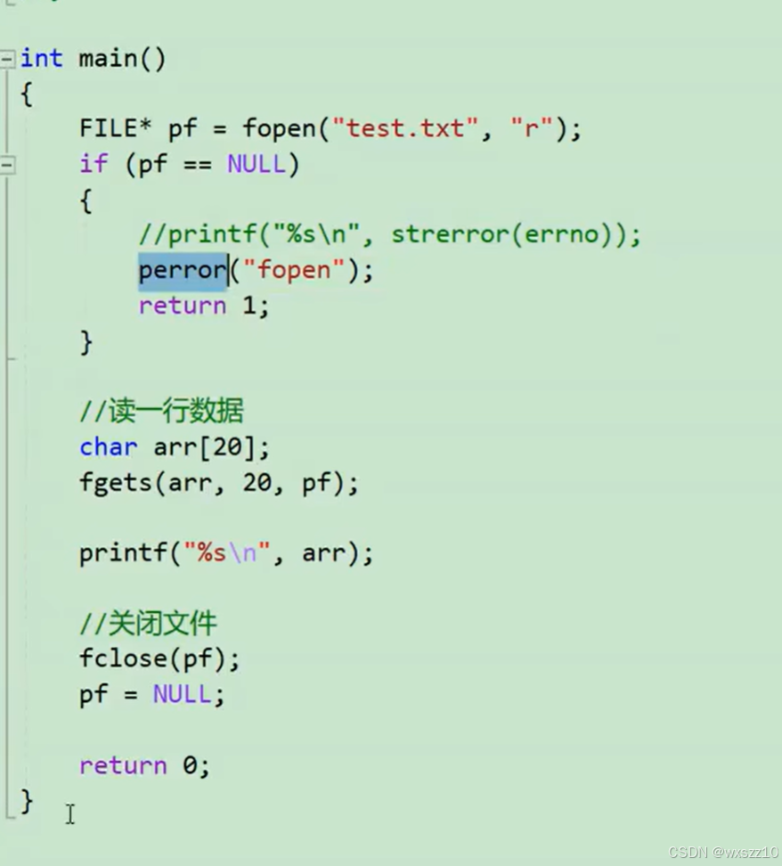
  - 这是把文件的内容输入到arr中
  - 3.向文件中输入的例子
  - 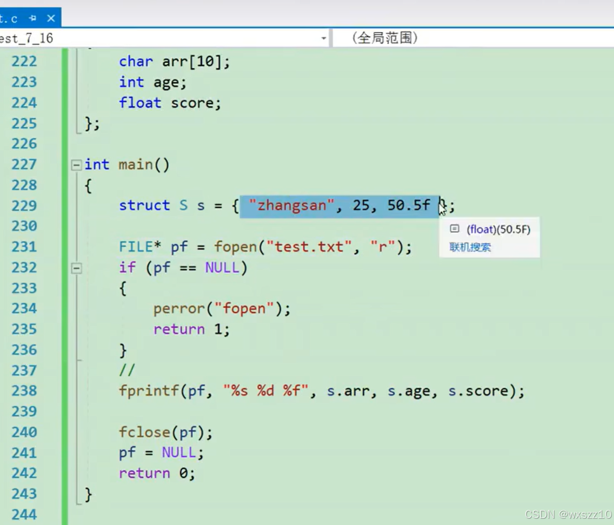
  - 用w模式打开文件，然后创造了结构体，再用标准输入到文件中
  - 4.流
  - 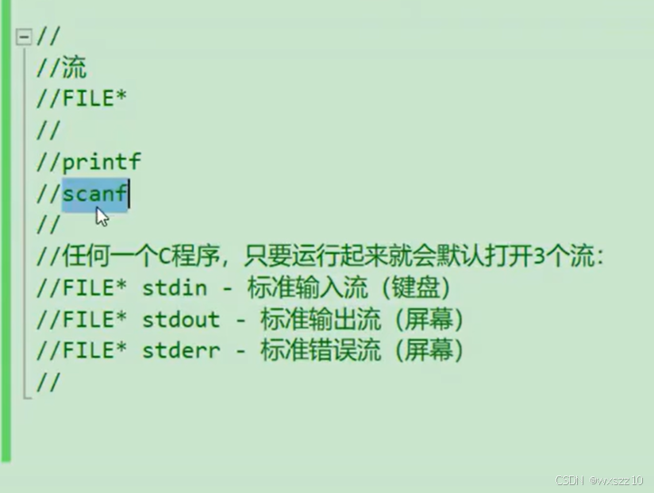
  - **流**是对数据输入输出（I/O）操作的一种高度抽象，形象地比喻为“流淌着字符的河”。它屏蔽了不同外部设备（如键盘、显示器、磁盘文件等）的具体实现细节，为程序员提供了一种统一的方式来处理各种设备的数据交换。通过流，我们只需关注数据的读写逻辑，而无需关心底层硬件接口的复杂性。
  - 在C程序中，无论是向屏幕输出文字、从键盘接收用户输入，还是读写文件内容，所有这些操作都被封装为对流的读写。这种统一的接口设计极大地提升了代码的可移植性和开发效率。
  - 5.几个函数的简单区分
  - 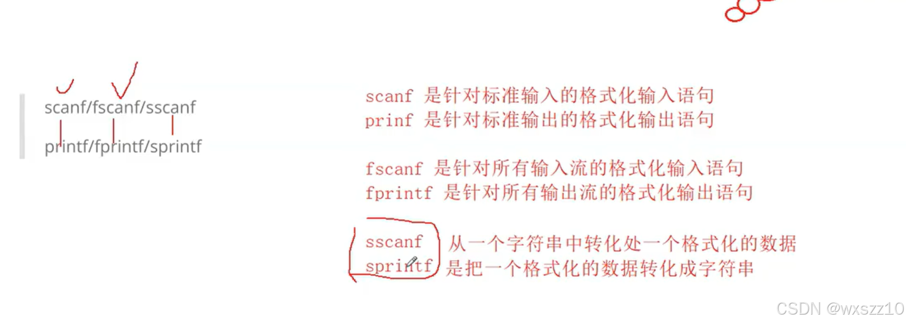操作文件所用的主要还是fscanf和fprintf。
  - 简单例子
  - 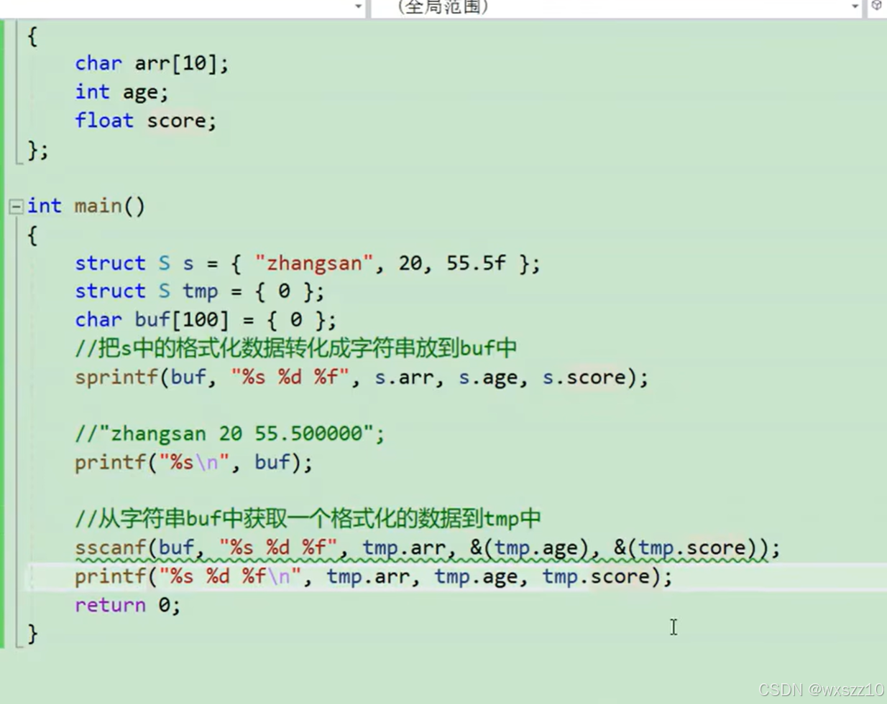
  - 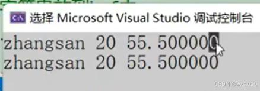
  - 6.实例，通过文件来记录通讯录中的信息，使联系人信息可以长久保留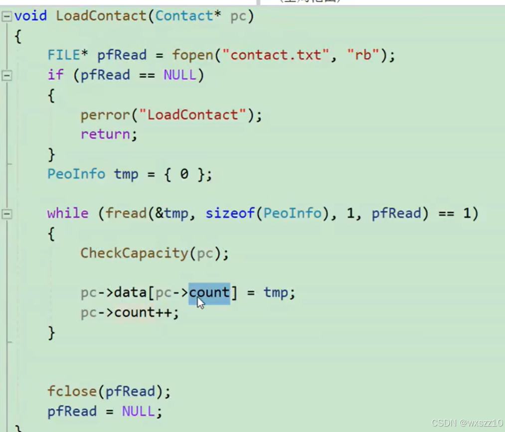
  - fread:
  - - `fread`函数用于从文件流中读取数据。它的原型是`size_t fread(void *ptr, size_t size, size_t count, FILE *stream);`。
    - 其中`ptr`是指向用于存储读取数据的内存块的指针，`size`是每个数据元素的大小（以字节为单位），`count`是要读取的元素个数，`stream`是指向要读取的文件流的指针（通过`fopen`打开文件后得到的`FILE`类型指针）。
      - 该函数的主要作用是从指定的文件流`stream`中读取`count`个大小为`size`字节的数据元素，并将它们存储到`ptr`所指向的内存区域中。读取成功后，`fread`函数返回实际读取的元素个数.
    - 因为不确定要存储多少个联系人的信息，所以一个个存储
    - 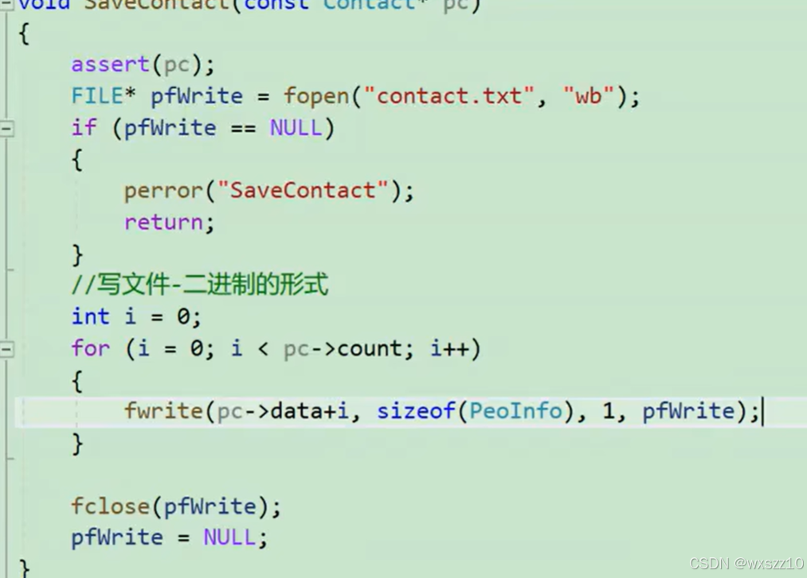
    - 这个是读取文件信息，将联系人一个个输入到data数组中
    - 7.fseek函数的使用
    - `fseek`函数用于移动文件位置指针。其函数原型为`int fseek(FILE *stream, long int offset, int whence);`。
    - 这个函数允许在文件内部进行定位，使得后续的文件读写操作可以从指定的位置开始。例如，可以将文件位置指针移动到文件的开头、中间或者结尾的某个位置。
    - 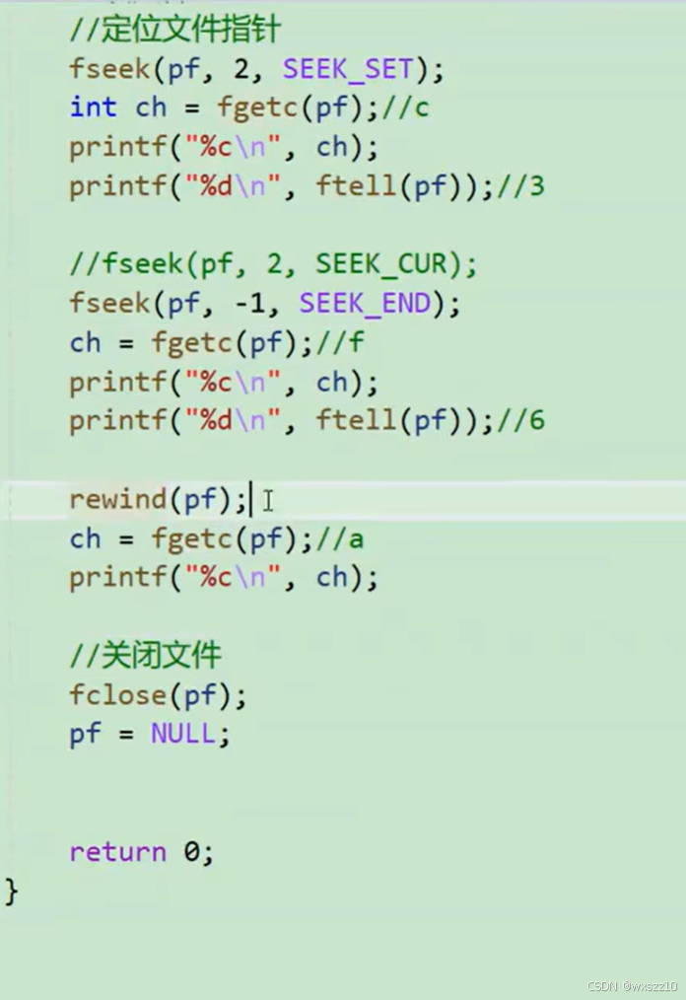
    - 其中，SEEK\_SET文件的起始位置，END是文件的末尾，CUR是上回使用后指针的位置，ftell是描述当前指针位置对于文件起始位置的偏移量

---

原文发表于 CSDN：[ 12.19学习笔记（文件的粗浅理解） ](https://blog.csdn.net/wxszz10/article/details/144583151)，作者：wxszz10。保留原文内容及图片。原文采用 [CC BY-SA 4.0](https://creativecommons.org/licenses/by-sa/4.0/) 协议。
