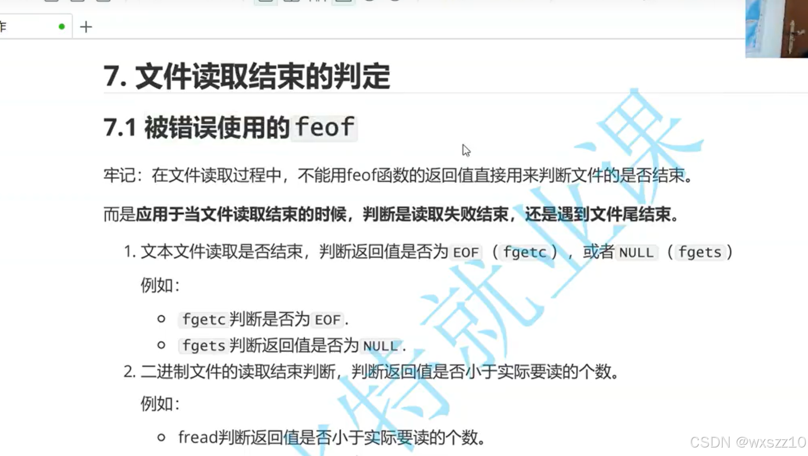
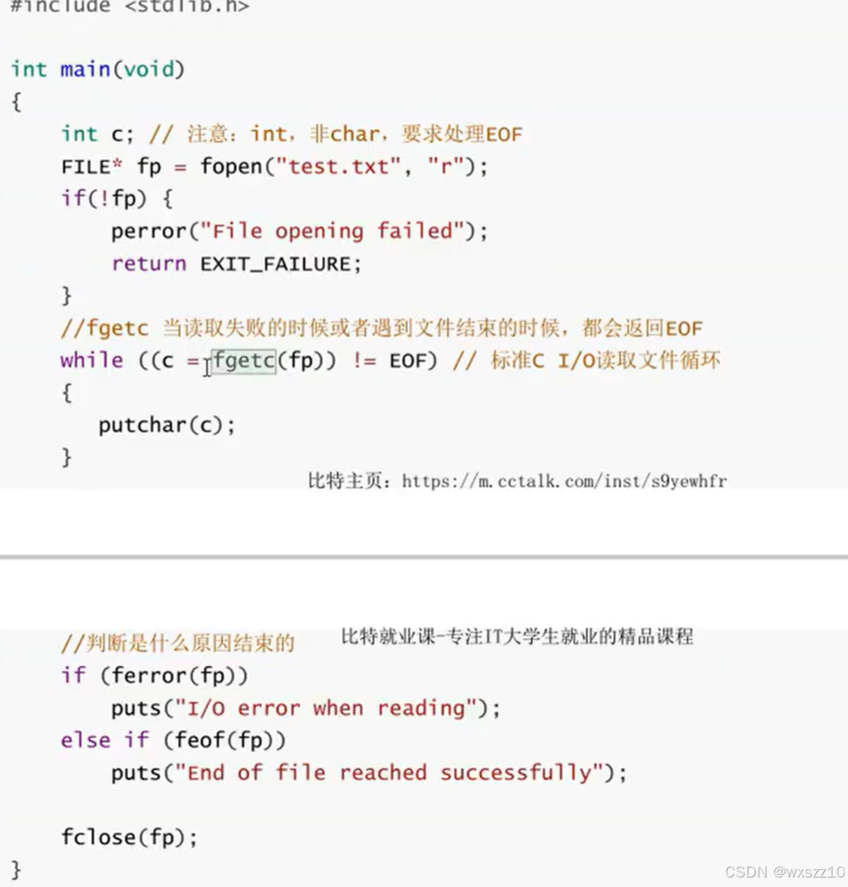
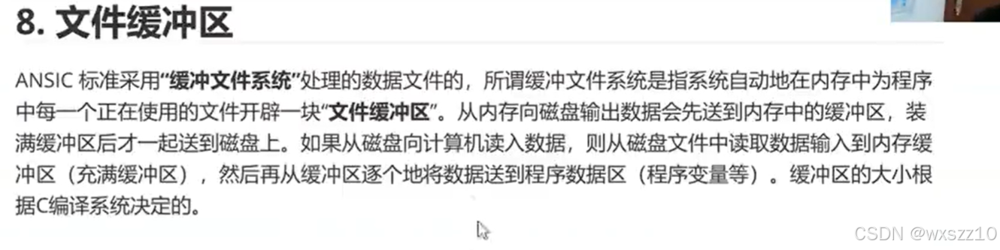
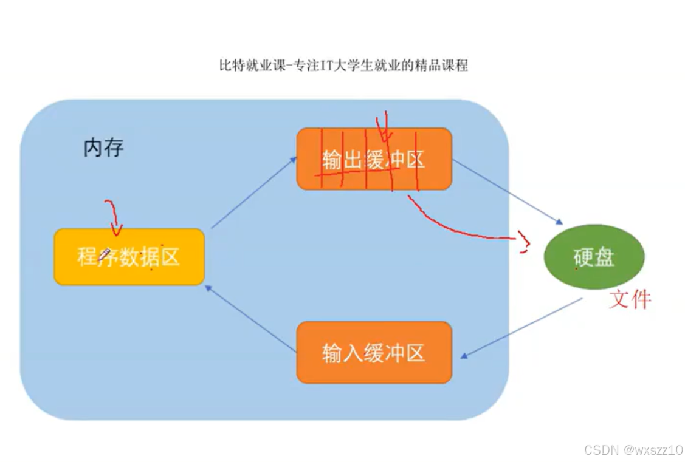
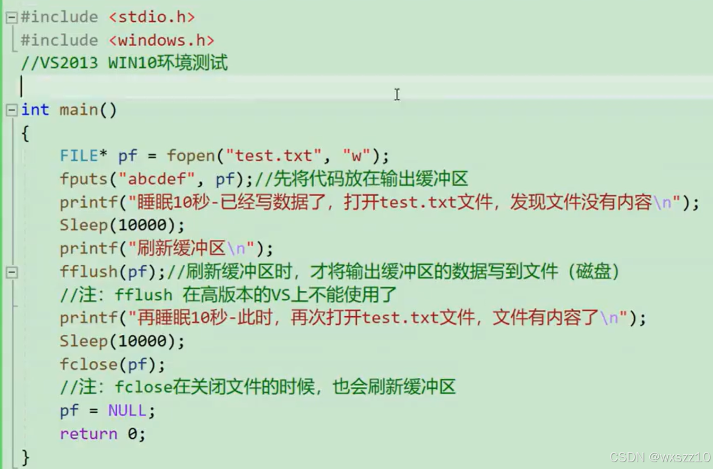
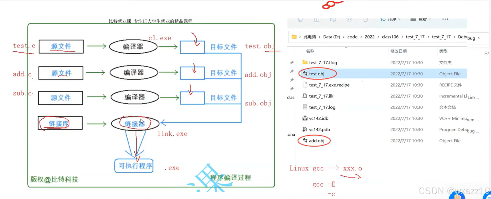
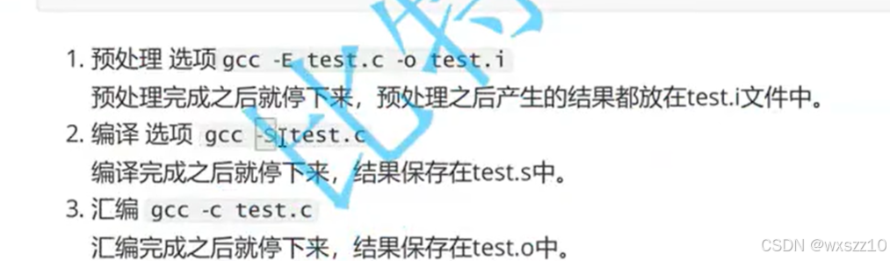
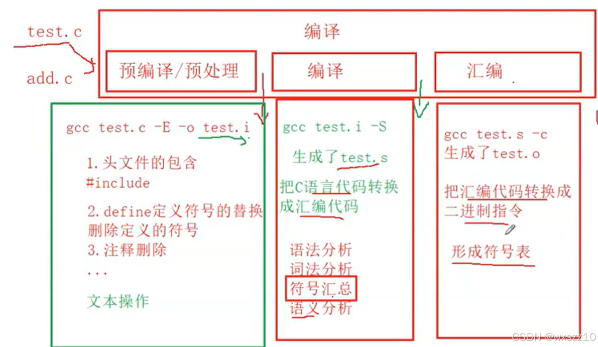
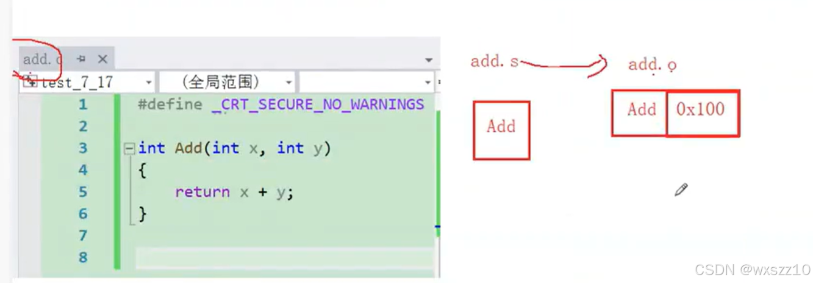
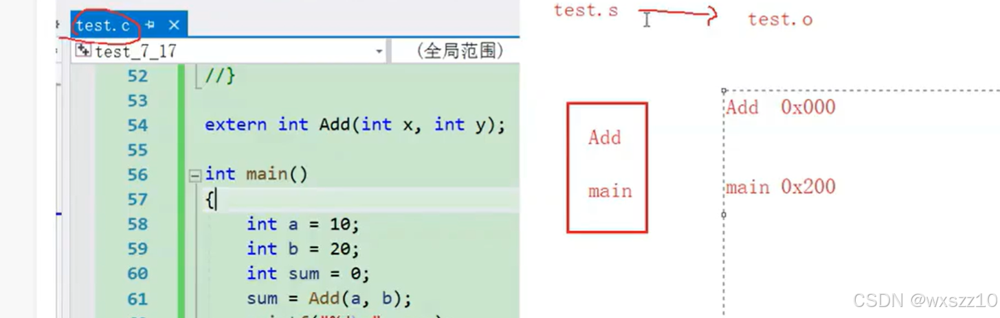

1.函数feof：

`feof`是一个 C 语言中的文件操作函数。它用于检测文件指针是否到达文件末尾。这个函数的原型是`int feof(FILE *stream)`，其中`stream`是一个指向已经打开的文件的指针。

下面是应用实例：

这是对文件进行读取并输出其内容，如果是因为错误结束读取文件ferror就会返回1，而如果因为文件内容被读取完毕而结束，feof就会返回1.

2.文件缓冲区

简单来说就是内存与硬件之间的一个缓冲区，作用就是减少调用系统，让效率更高。

以下是证明缓冲区存在的代码：

在程序运行的前10秒内，test.txt没有内容，但过了10秒后，文件中就出现了abcdef这一内容，由此证明了文件缓冲区的存在。

3.预处理

下面这是我们写的代码转换到可执行程序的过程

编译主要分为以下三个步骤：

以下是各步骤具体作用

下面是符号汇总（符号指的就是函数名）的例子

---

原文发表于 CSDN：[ 12.20学习笔记（文件的一些补充知识点以及预处理） ](https://blog.csdn.net/wxszz10/article/details/144607417)，作者：wxszz10。保留原文内容及图片。原文采用 [CC BY-SA 4.0](https://creativecommons.org/licenses/by-sa/4.0/) 协议。
