（1）.在生成可执行程序的过程中，一般会生成以下文件：

1. **预处理文件（.i 文件，以 C/C++ 为例）**
   - 在 C 和 C++ 语言中，编译的第一步是预处理。如前面所述，当使用`gcc -E`（对于 C 语言）或`g++ -E`（对于 C++ 语言）命令时，会生成预处理文件（.i 文件）。这个文件展开了所有的`#include`指令，完成了宏替换等预处理操作。例如，`#include <stdio.h>`会将`stdio.h`文件的内容插入到源文件中相应的位置，宏定义（如`#define PI 3.14`）会将代码中所有的`PI`替换为`3.14`。
2. **汇编文件（.s 文件）**
   - 预处理后的下一步是编译，编译过程会将预处理后的代码转换为汇编语言代码，生成.s 文件。例如，对于一个简单的 C 函数`int add(int a, int b) { return a + b; }`，其对应的汇编文件可能包含了诸如`mov`（数据传送指令）、`add`（加法指令）等汇编指令，用于在机器的寄存器和内存之间操作数据来实现加法功能。不同的处理器架构（如 x86、ARM 等）会有不同的汇编指令集，生成的.s 文件内容也会因架构而异。
3. **目标文件（.o 文件）**
   - 汇编文件经过汇编器处理后会生成目标文件（.o 文件）。目标文件包含了机器代码，但是还不能直接执行。它是一种中间文件，在链接阶段会被用到。一个程序可能会有多个.o 文件，例如，如果一个项目有多个源文件（如`main.c`、`func1.c`、`func2.c`），经过编译后会分别生成`main.o`、`func1.o`、`func2.o`等目标文件。这些目标文件中包含了各个源文件编译后的机器码，以及一些关于变量、函数等的符号信息，用于在链接阶段进行符号解析。
   - 以下是创造了Add、main函数然后生成汇编文件以及最后链接在一起的过程

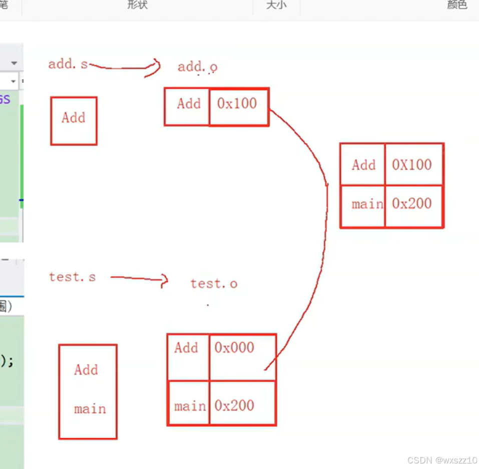

为了让系统能识别文件，在linux环境下都按照elf格式来编译文件

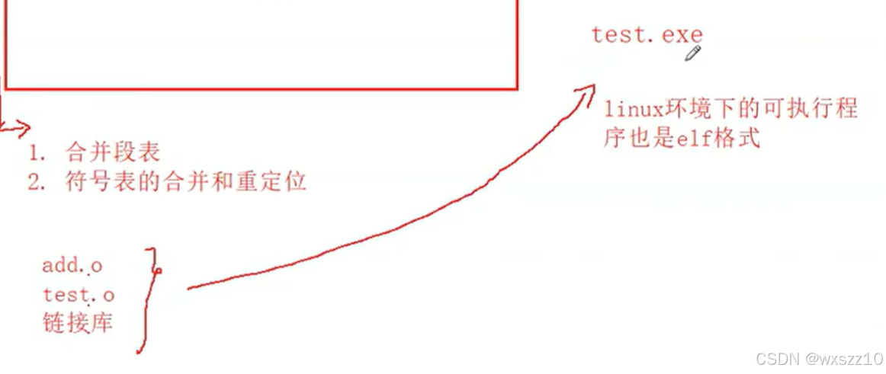

2.提前定义过的符号

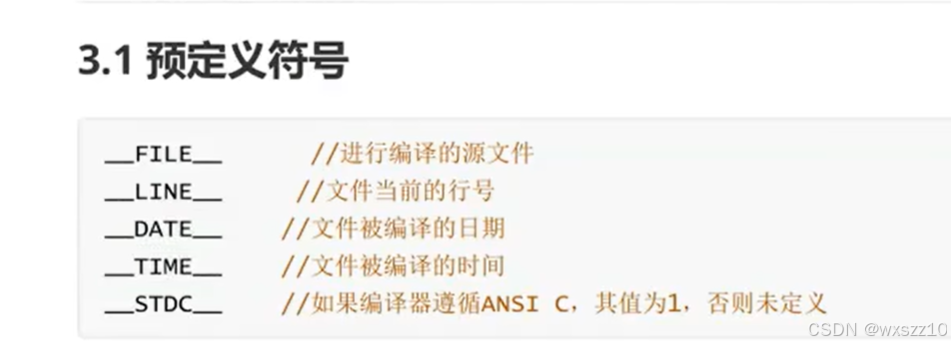

以下是一些使用例子：

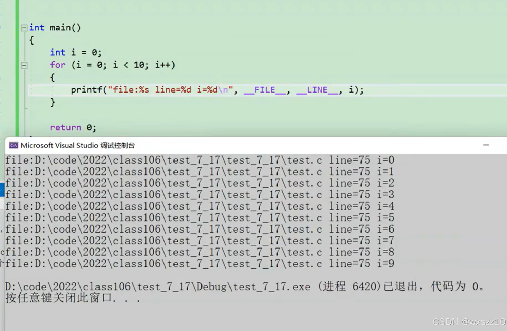

用\_FILE\_和\_LINE\_找到了文件的位置以及行号.

3.fscanf

无论是fscanf还是fprintf都要记得主题是程序，所以scanf是向程序输入数据，fprintf是向文件输出数据

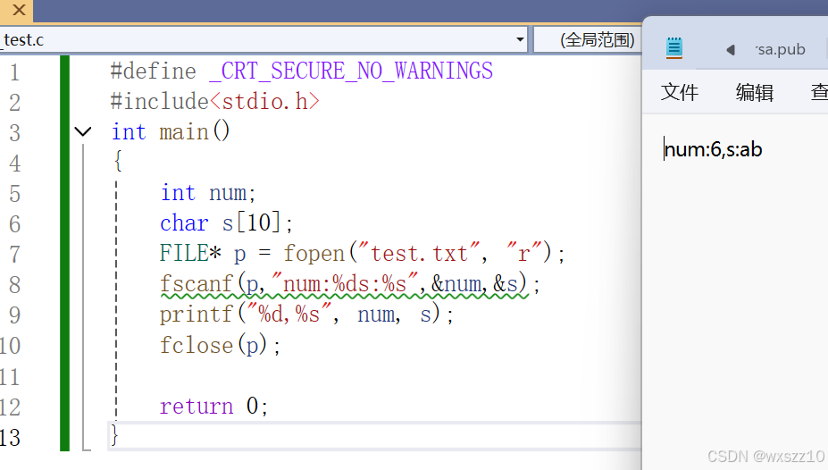

4.下面是选择性编译，很厉害的东西

下面举几个例子

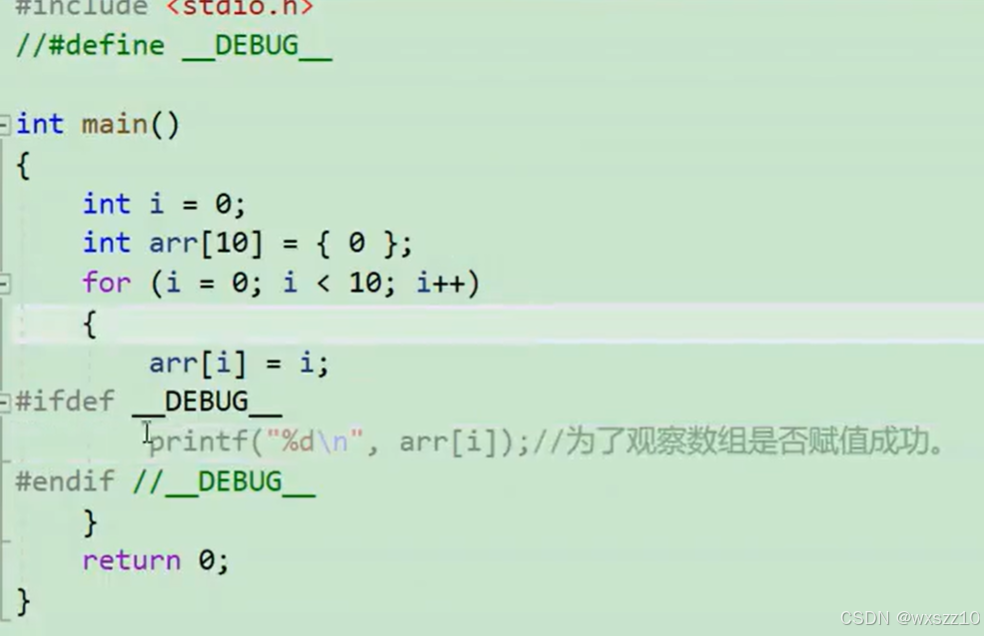

#ifdef如果定义了DEBUG那么就运行下面的程序，#endif与其是一对，一个开头，一个结尾。

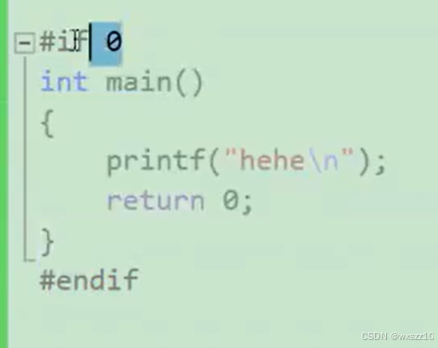

这个用法和if一样

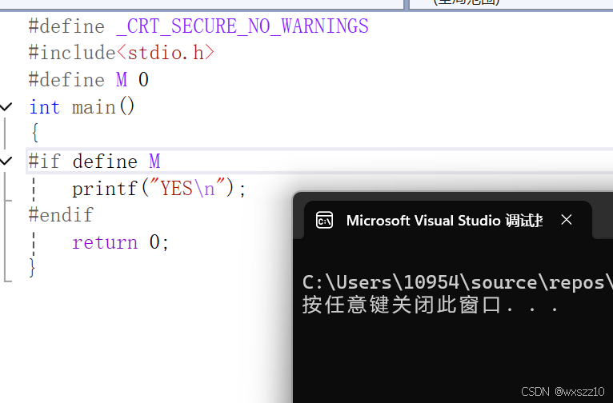

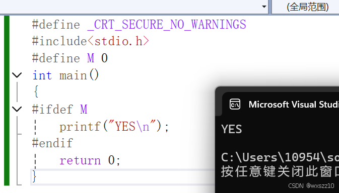

这个也与if一样

5.在.h文件中防止反复引用的方法

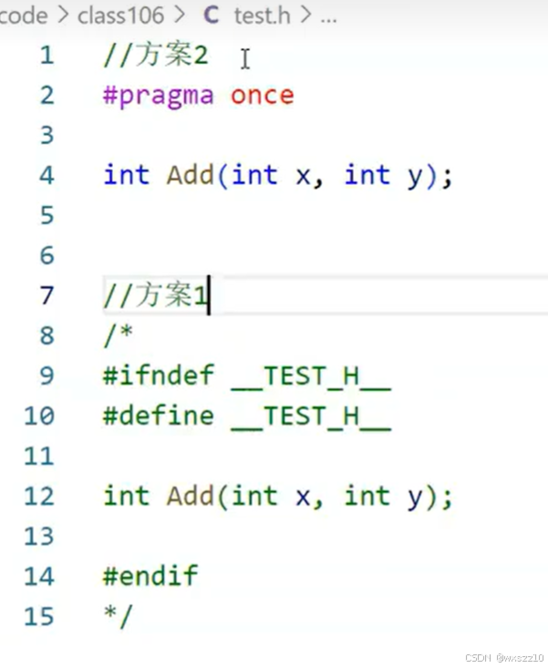

6.在引用头文件时需要注意的地方

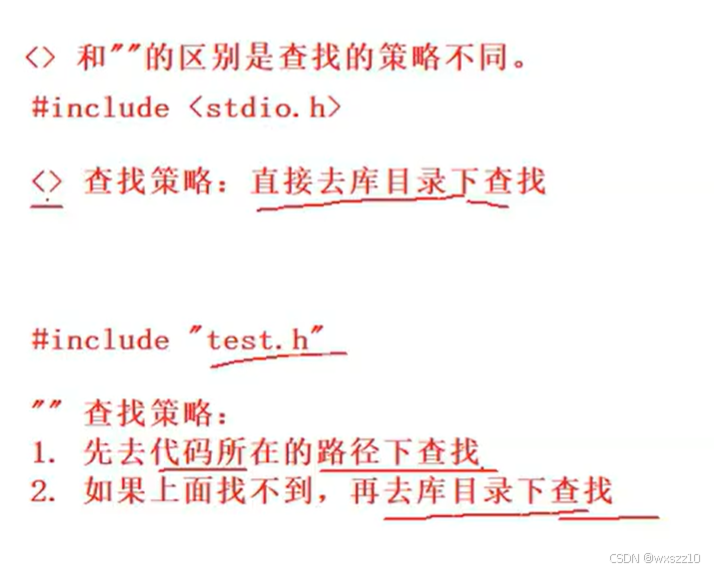

7.用定义宏的方法模拟offsetof函数（用来计算元素偏移量的函数）

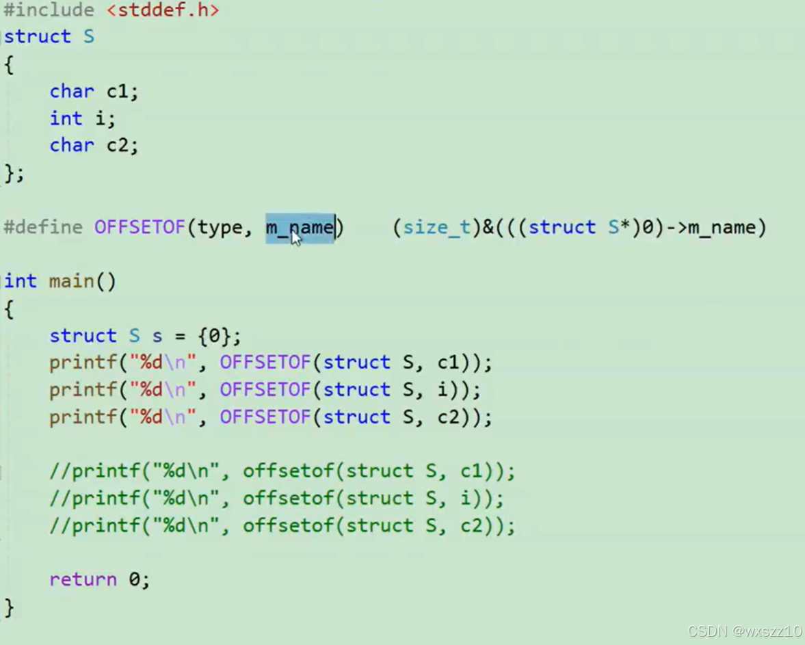

很厉害的是：在定义OFFSETOF时直接将0作为了变量的首地址。

---

原文发表于 CSDN：[ 12.24学习笔记（预处理及一些编译过程） ](https://blog.csdn.net/wxszz10/article/details/144691774)，作者：wxszz10。保留原文内容及图片。原文采用 [CC BY-SA 4.0](https://creativecommons.org/licenses/by-sa/4.0/) 协议。
