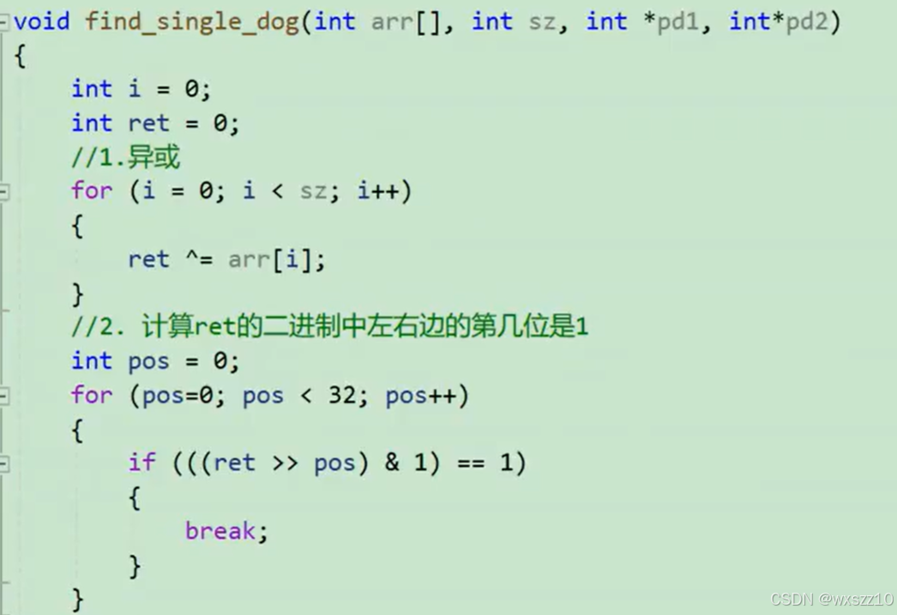
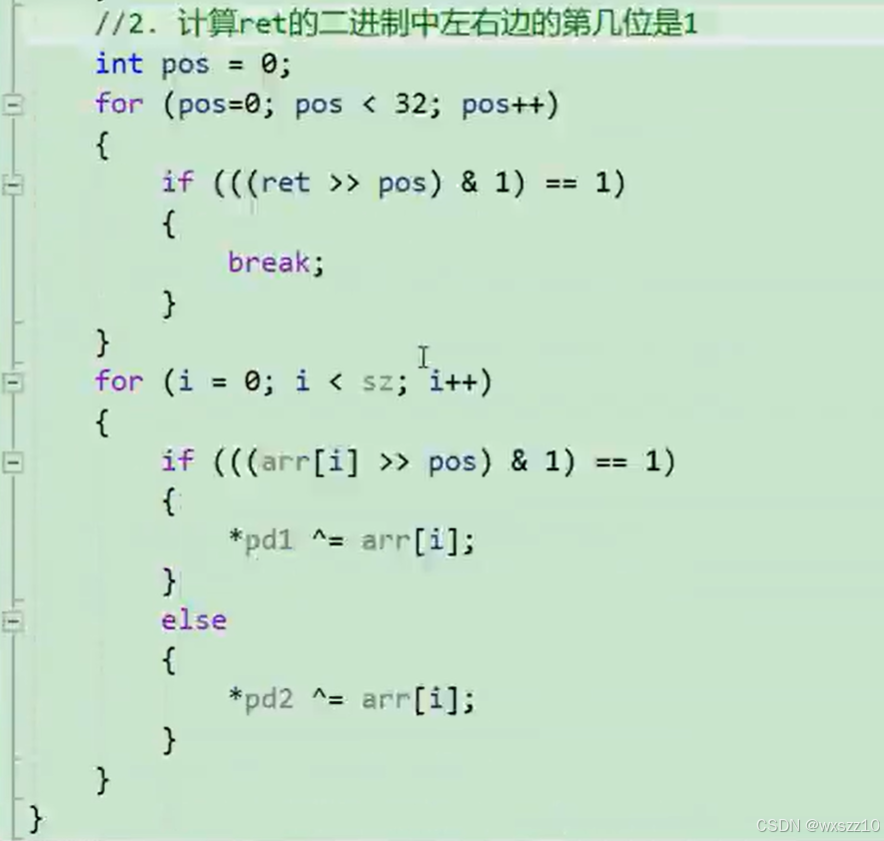
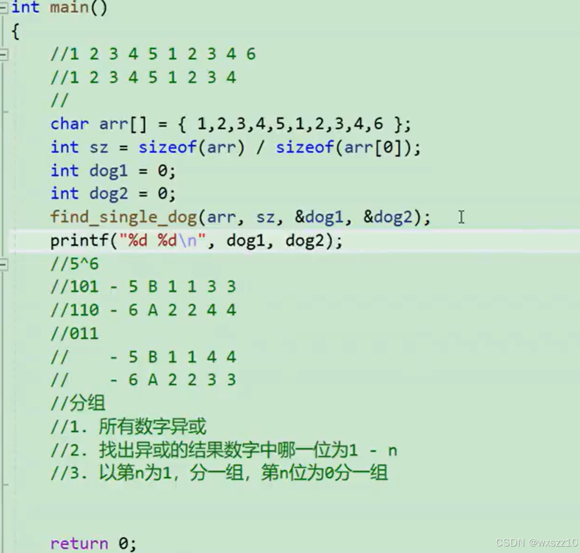
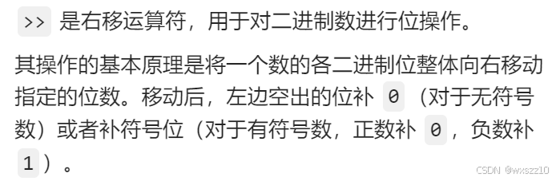

问题：在一组数中找到没有重复的两个数

解决方案：

解析：

思路：先将两个数分开，分成两组数据，然后通过异或的方法得到单身狗

方法：先要知道异或是什么，且其特点

&gt;&gt;：右移运算符

因为是以二进制存储数据，所以先找到那两个单身狗二进制时不同的位，通过这个位，来将数据分为两组，最后通过相同数异或为0这一特征，得到单身狗。

存储空间的小知识点：

---

原文发表于 CSDN：[ 找到两只单身狗（12.25） ](https://blog.csdn.net/wxszz10/article/details/144718012)，作者：wxszz10。保留原文内容及图片。原文采用 [CC BY-SA 4.0](https://creativecommons.org/licenses/by-sa/4.0/) 协议。
