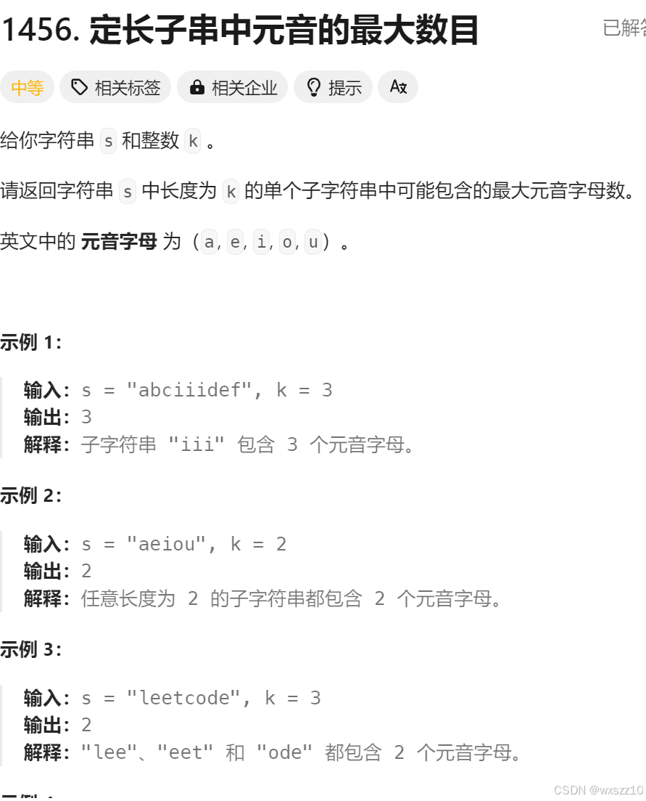

题目：在leetcode上



解释：什么是滑动窗口呢，在这道题里面，子串的长度为k,所以我们就可以将这个子串看为一个窗口，每次去统计窗口里面有多少满足要求，然后进行相关值的加减，滑动就体现在子串的第一个元素离开窗口，紧接着本来在窗口后的元素进入窗口，这样的步骤就像是窗口向后滑动了一样。

优点：这样相比较暴力求解，大大减小了运算量，复杂度为o(n)，相对于暴力的o(nk)少了很多。

下面是按照这个算法写的代码

```
#define MAX(a,b) (a)>(b)?(a):(b)

int maxVowels(char* s, int k) {

int ans=0,vowel=0;

for(int i=0;s[i];i++){

    //1.进入窗口

if(s[i]=='a'||s[i]=='e'||s[i]=='i'||s[i]=='o'||s[i]=='u'){

    vowel++;

}

if(i<k-1){

continue;

}

//2.更新答案

ans=MAX(ans,vowel);

//3.离开窗口

char out=s[i-k+1];

if(out=='a'||out=='e'||out=='i'||out=='o'||out=='u')

{

    vowel--;

}

}

return ans;

}
```

---

原文发表于 CSDN：[ 25.1.10学习笔记（算法（滑动窗口）） ](https://blog.csdn.net/wxszz10/article/details/145053155)，作者：wxszz10。保留原文内容及图片。原文采用 [CC BY-SA 4.0](https://creativecommons.org/licenses/by-sa/4.0/) 协议。
